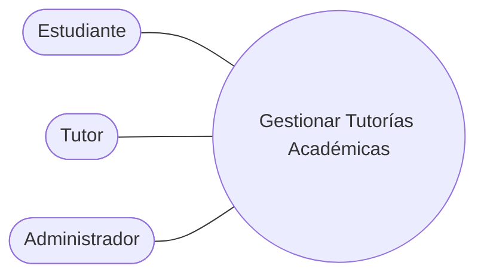

# 0.1 Core del Negocio — Caso de Uso de Alto Nivel

> El core resume el objetivo principal del sistema en un solo caso de uso. Es la vista de caja negra: muestra quién interactúa con el sistema y qué se espera de él, sin entrar en detalles internos.

## Diagrama del core del negocio

Archivo: `educonnect-casos-de-uso.drawio` → página **0.1 Core**.

## Caso de uso core

**Gestionar Tutorías Académicas**

## Descripción del core

Plataforma web que conecta a estudiantes con tutores para agendar, atender y evaluar sesiones de tutoría. El administrador valida el ingreso de cada usuario y controla la plataforma. El estudiante recibe un plan de estudio con las dificultades identificadas y los recursos recomendados, y la plataforma ofrece reportes de conducta, de calificación y analíticos para la toma de decisiones.

## Actores

| Actor | Tipo | Qué espera del sistema |
|-------|------|------------------------|
| Estudiante | Primario | Encontrar un tutor, agendar sesiones, recibir su plan de estudio y calificar o reportar la atención recibida. |
| Tutor | Primario | Publicar su disponibilidad, atender sesiones, registrar el plan de estudio del estudiante y calificar o reportar estudiantes. |
| Administrador | Primario | Aprobar o dar de baja usuarios, resolver reportes de conducta y consultar reportes para tomar decisiones. |

## Trazabilidad

El core cubre las 40 historias de usuario (HU-01 a HU-40). Su descomposición en procesos está en `0.2-primera-descomposicion.md`.