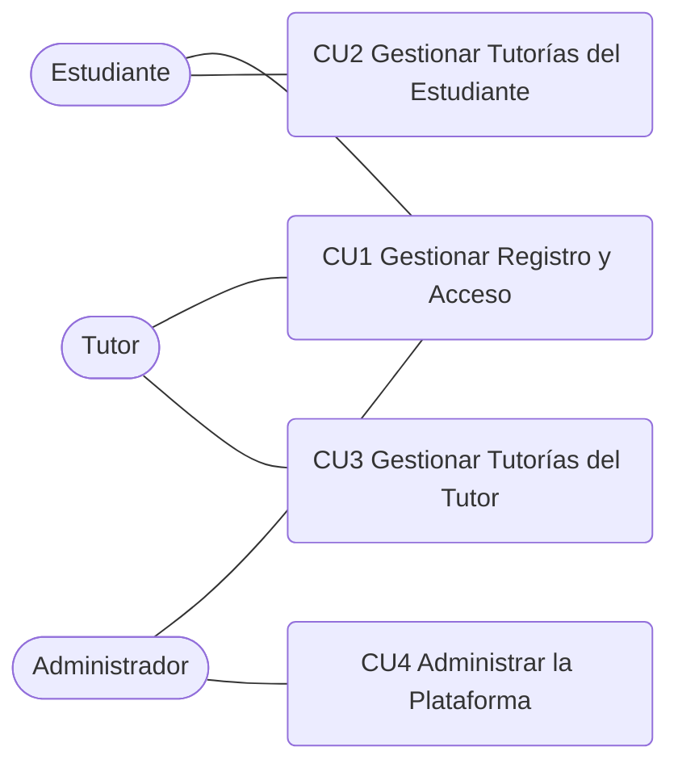

# 0.2 Primera Descomposición del Core

> La primera descomposición transforma el core en procesos generales del negocio; cada proceso representa un flujo completo con un resultado de valor.

## Diagrama de la primera descomposición

Archivo: `educonnect-casos-de-uso.drawio` → página **0.2 Primera descomposición**.

## Procesos del negocio

| ID | Proceso | Actores | Resultado de valor | Historias de usuario |
|----|---------|---------|--------------------|----------------------|
| CU1 | Gestionar Registro y Acceso | Estudiante, Tutor, Administrador | El usuario queda registrado, con correo validado y autenticado en el panel de su rol. | HU-01, 02, 03, 04, 22, 23, 24 |
| CU2 | Gestionar Tutorías del Estudiante | Estudiante (Administrador recibe sus reportes) | El estudiante encuentra tutor, agenda y gestiona sesiones, recibe su plan de estudio y valora la atención. | HU-16 a HU-21, HU-25 a HU-28 |
| CU3 | Gestionar Tutorías del Tutor | Tutor (Estudiante y Administrador reciben notificaciones y reportes) | El tutor publica su disponibilidad, atiende o cancela sesiones y registra el plan de estudio. | HU-10 a HU-15, HU-29 a HU-31 |
| CU4 | Administrar la Plataforma | Administrador (Estudiante y Tutor reciben notificaciones) | El administrador controla quién accede, resuelve reportes de conducta y obtiene reportes para decidir. | HU-05 a HU-09, HU-32 a HU-40 |

## Actores por proceso

| Actor | CU1 Registro y Acceso | CU2 Tutorías del Estudiante | CU3 Tutorías del Tutor | CU4 Administración |
|-------|:---:|:---:|:---:|:---:|
| Estudiante | ✔ | ✔ | | |
| Tutor | ✔ | | ✔ | |
| Administrador | ✔ | | | ✔ |

## Equivalencia con los módulos de los requerimientos

Los procesos coinciden con los módulos usados en el documento de requerimientos: CU1 = Registro y Autenticación, CU2 = Estudiante, CU3 = Tutor y CU4 = Administrador. Los IDs de los casos de uso expandidos (CUx-y) son los mismos que usan los RF (RF-x-y-z).

## Siguiente paso

Cada proceso se expande en casos de uso específicos (40 en total) en `0.3-cun-expandidos.md`.