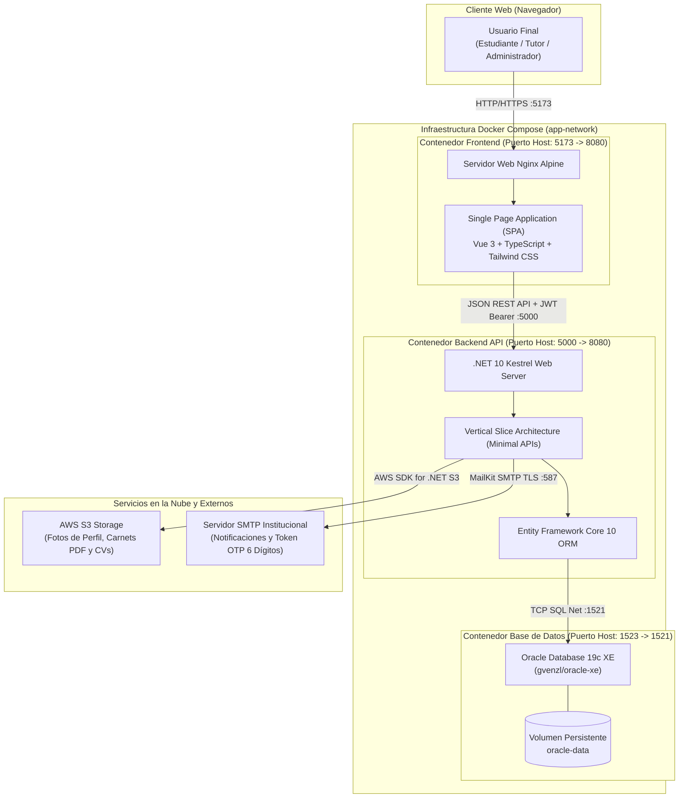
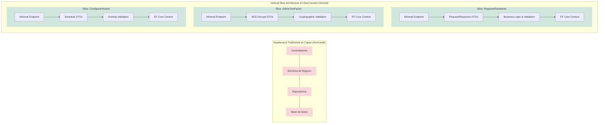
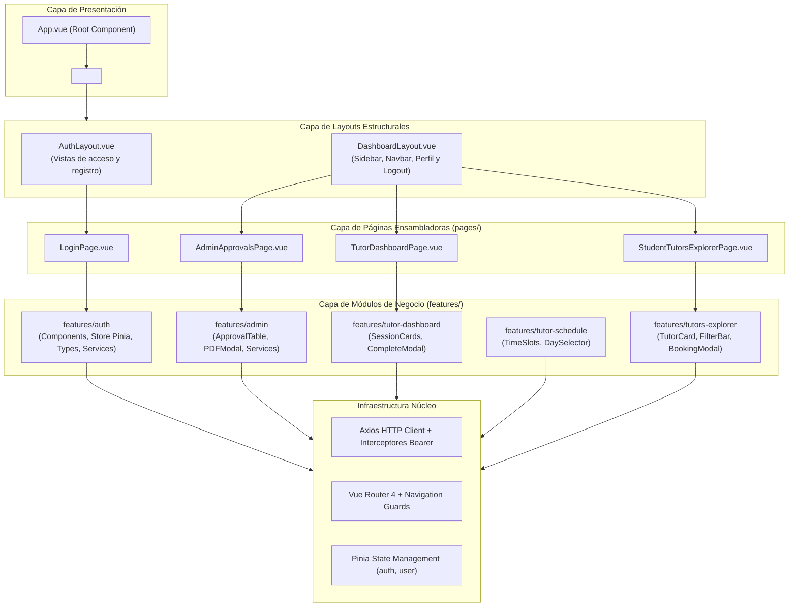
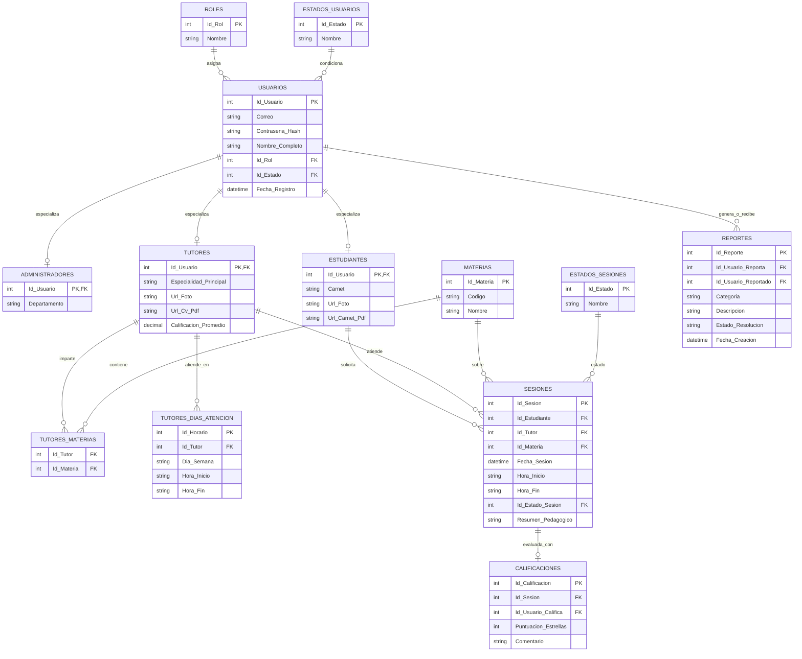
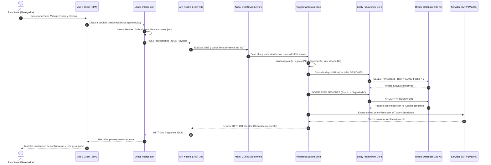

# Arquitectura del Sistema y Modelo de Implementación — EduConnect

### Documentos relacionados
- [Manual Técnico de Arquitectura e Instalación](../manual-tecnico/manual-tecnico.md)
- [Requerimientos Funcionales](../requerimientos/RF.md)
- [Requerimientos No Funcionales (Calidad)](../requerimientos/RNF-Calidad%20(EAC).md)
- [Requerimientos No Funcionales (Restricción)](../requerimientos/RNF-Restriccion.md)
- [Tablero Kanban y Evidencias Scrum](../tablero-kanban/tablero.md)
- [Diagrama Entidad-Relación](../diagrama-er/edu-connect-er.pdf)
- [Prototipos en Google Stitch](../prototipos/prototipos-stitch.md)

**Universidad de San Carlos de Guatemala (USAC)**  
**Facultad de Ingeniería — Escuela de Ciencias y Sistemas**  
**Análisis y Diseño de Sistemas 1 (AYD1) — Segundo Semestre 2026**  
**Grupo 7**

---

### Ficha Técnica del Proyecto
* **Nombre de la Plataforma:** EduConnect — Sistema Integral de Gestión de Tutorías Académicas
* **Repositorio Oficial:** [Grupo 7 - AYD1](https://github.com/Sebastian-G-0607/AYD1_2S_G7.git)
* **Entorno de Ejecución:** Contenedorizado Multi-Servicio con Docker Compose
* **Equipo de Desarrollo:**

| Nombre Completo | Carnet | Rol Principal |
| :--- | :---: | :---: |
| **Carlos Eduardo Lau López** | 202202812 | **Scrum Master** / Desarrollador Backend & Frontend |
| **Eduardo Sebastián Gutiérrez Felipe** | 202300694 | **Product Owner** / Desarrollador Full-Stack |
| **Christian David Chinchilla Santos** | 202308227 | Equipo de Desarrollo (Backend & QA) |
| **Josue Daniel Revolorio Martinez** | 202102984 | Equipo de Desarrollo (Frontend & Reportes) |
| **Sebastian Antonio Romero Tzitzimit** | 202201690 | Equipo de Desarrollo (Full-Stack & Seguridad) |
| **Keitlyn Valentina Tunchez Castañeda** | 202201139 | Equipo de Desarrollo (Frontend & Validaciones) |

---

## 1. Introducción y Objetivos Arquitectónicos

El propósito fundamental de este documento es describir formal y técnicamente la **arquitectura de software** y los **modelos de diseño** implementados en la construcción de **EduConnect**.

EduConnect es una plataforma web orientada a la vinculación pedagógica, agendamiento de tutorías, validación de credenciales académicas, seguimiento del desempeño estudiantil y control analítico institucional. Para cumplir con las altas exigencias del curso y garantizar un software robusto, mantenible y de grado profesional, la arquitectura se rigió por los siguientes objetivos de calidad:

1. **Desacoplamiento Estricto:** Separación total de responsabilidades entre la capa de presentación (Frontend SPA), la capa de servicios lógicos (Backend REST API) y el motor de almacenamiento persistente (Oracle XE).
2. **Alta Cohesión por Características de Negocio:** Adopción del patrón **Vertical Slice Architecture (VSA)** en el backend y **Feature-Driven Architecture** en el frontend, evitando la dispersión horizontal del código.
3. **Rendimiento y Ligereza:** Uso de **ASP.NET Core Minimal APIs** en .NET 10 para eliminar la sobrecarga de reflexión de los controladores clásicos, junto con la reactividad optimizada de **Vue 3 Composition API**.
4. **Seguridad Integral por Diseño:** Autenticación basada en **JWT**, encriptación con **BCrypt**, segundo factor de autenticación (**2FA**) criptográfico con AES-256 y códigos de un solo uso (**OTP** de 6 dígitos), y control de acceso basado en roles (**RBAC**).
5. **Portabilidad Absoluta:** Infraestructura como código orquestada mediante **Docker Compose**, asegurando paridad exacta entre entornos de desarrollo, pruebas y producción.

---

## 2. Visión General del Estilo Arquitectónico Global

EduConnect implementa un estilo arquitectónico **Cliente-Servidor Desacoplado** (*Decoupled Client-Server Architecture*) estructurado en contenedores Docker autónomos que se comunican mediante protocolos estándares de red sobre una red tipo puente (*bridge network*).



<!-- [IMAGEN: Diagrama General de Arquitectura de EduConnect - Contenedores, Red y Servicios Externos] -->

### 2.1 Componentes Principales de la Arquitectura

1. **Capa Cliente (Frontend SPA):**
   - Interfaz web interactiva de una sola página desarrollada en **Vue 3** y empaquetada con **Vite**.
   - Servida mediante **Nginx** en modo proxy/estático dentro de un contenedor Docker ligero basado en Alpine Linux.
   - No mantiene estado en servidor de sesión; toda la identidad reside en el cliente mediante **JSON Web Tokens (JWT)** almacenados de forma segura en el almacenamiento local.

2. **Capa de Negocio y Servicios (Backend REST API):**
   - API de alto rendimiento desarrollada sobre **.NET 10 (C# 14)** y ejecutada por el servidor web Kestrel.
   - Implementa **Vertical Slice Architecture**, exponiendo endpoints REST declarativos a través de **Minimal APIs**.
   - Integra servicios de infraestructura compartida para validaciones, logging, CORS, manejo global de excepciones y seguridad criptográfica.

3. **Capa de Persistencia (Base de Datos Relacional):**
   - Motor de base de datos corporativo **Oracle Database 19c Enterprise Edition / XE**.
   - Acceso a datos completamente administrado por el Object-Relational Mapper (ORM) **Entity Framework Core 10**.
   - Los datos residen en un volumen persistente de Docker (`oracle-data`), impidiendo la pérdida de información ante detenciones o reconstrucciones de contenedores.

4. **Servicios de Soporte en la Nube:**
   - **AWS S3 (Amazon Simple Storage Service):** Almacenamiento seguro y desacoplado de archivos pesados y probatorios: fotografías de perfil, carnets de estudiante en formato PDF y currículums vitae (CV) de tutores en PDF.
   - **Servidor SMTP (MailKit):** Proveedor transaccional de correo electrónico para el envío de notificaciones automáticas (aprobación de cuenta, rechazo justificado, cancelación de tutorías) y el despacho de tokens de verificación de 6 dígitos.

---

## 3. Arquitectura y Modelo de Implementación del Backend (.NET 10)

### 3.1 El Modelo: Vertical Slice Architecture (VSA)

Tradicionalmente, las aplicaciones empresariales se han diseñado utilizando una **Arquitectura en Capas (N-Tier)** o arquitectura en cebolla (*Clean/Onion Architecture*), divididas horizontalmente en capas rígidas: `Controllers/`, `Services/`, `Repositories/`, `Entities/` y `DTOs/`. 

En EduConnect se **descartó conscientemente la arquitectura en capas tradicional** debido a sus desventajas conocidas en proyectos ágiles:
* **Alto acoplamiento horizontal:** Para agregar o modificar una funcionalidad (ej. *Aprobar Tutor*), el desarrollador debía modificar 4 o 5 archivos en carpetas distintas.
* **Abstracciones innecesarias:** Existencia de repositorios y servicios que solo actuaban como pasarelas pasivas (*pass-through code*) hacia el ORM sin aportar lógica de negocio.

En su lugar, se adoptó **Vertical Slice Architecture (VSA)**:



<!-- [IMAGEN: Diagrama de Vertical Slice Architecture en el Backend de .NET 10] -->

#### Principios Clave de Vertical Slice en EduConnect:
1. **Cohesión Máxima:** Todo lo necesario para satisfacer un requerimiento de negocio se ubica en el mismo directorio. Si la funcionalidad cambia o se retira, solo se toca ese directorio sin riesgo de efectos secundarios (*side-effects*) en otros módulos.
2. **Aislamiento de DTOs:** Cada slice posee sus propios objetos de transferencia de datos de entrada (*Request*) y salida (*Response*). No se comparten DTOs entre casos de uso disímiles, evitando que cambios en una pantalla rompan inadvertidamente otra.
3. **Minimal APIs:** En lugar de heredar de `ControllerBase`, cada slice expone un método de extensión estático (ej. `app.MapRegistrarEstudiante()`) que registra las rutas directamente sobre el motor de enrutamiento de ASP.NET Core.

---

### 3.2 Organización del Proyecto Backend (`edu-connect-service.Api`)

La estructura física del repositorio refleja fielmente el patrón arquitectónico:

```
edu-connect-service/src/edu-connect-service.Api/
├── Data/                             # Infraestructura de Persistencia
│   ├── Configurations/               # Mapeos Fluent API por Entidad (IEntityTypeConfiguration)
│   ├── Migrations/                   # Historial de Migraciones de Entity Framework Core
│   ├── DataExtensions.cs             # Métodos de extensión para DI, migraciones y seed
│   └── edu-connect-serviceContext.cs # DbContext principal de EF Core
│
├── Features/                         # VERTICAL SLICES (Módulos de Negocio)
│   ├── Administrador/                # Casos de uso del rol Administrador
│   │   ├── AdministradorEndpoints.cs # Enrutador maestro del módulo admin
│   │   ├── GestionEstudiantes/       # Slices de auditoría, listado y bajas de alumnos
│   │   └── GestionTutores/           # Slices de aprobación con visor PDF y bajas de tutores
│   │
│   ├── Auth/                         # Casos de uso de Identidad y Acceso
│   │   ├── AdminTwoFactor/           # Validación de 2FA criptográfico (AES-256-CBC)
│   │   ├── AuthEndpoints.cs          # Mapeo de rutas /auth/login y /auth/me
│   │   ├── Login/                    # Autenticación multifactor y generación de JWT
│   │   └── Me/                       # Consulta del usuario autenticado actual
│   │
│   ├── Estudiantes/                  # Casos de uso del Estudiante
│   │   ├── EstudiantesEndpoints.cs   # Enrutador maestro /estudiantes
│   │   └── RegistrarEstudiante/      # Registro multipart con foto S3 y carnet PDF
│   │
│   ├── Tutores/                      # Casos de uso del Tutor
│   │   ├── ConfigurarHorario/        # Gestión y validación de franjas de disponibilidad
│   │   ├── RegistrarTutor/           # Registro con foto S3, CV en PDF y especialidades
│   │   └── TutoresEndpoints.cs       # Enrutador maestro /tutores
│   │
│   ├── Materias/                     # Catálogo académico transversal
│   │   ├── MateriasEndpoints.cs      # Endpoint /materias
│   │   └── ObtenerMaterias/          # Listado optimizado para selectores
│   │
│   └── Health/                       # Monitoreo de salud del contenedor y base de datos
│       ├── HealthDtos.cs
│       └── HealthEndpoints.cs        # Endpoint /health para Docker y orquestadores
│
├── Models/                           # Entidades del Dominio del Negocio (POCOs)
│   ├── Usuario.cs, Rol.cs, EstadoUsuario.cs
│   ├── Administrador.cs, Estudiante.cs, Tutor.cs
│   ├── Materia.cs, TutorMateria.cs, TutorDiaAtencion.cs
│   └── Sesion.cs, EstadoSesion.cs
│
├── Shared/                           # Preocupaciones Transversales (Cross-Cutting Concerns)
│   ├── Authentication/               # Configuración de JWT Bearer y JwtTokenService
│   ├── Authorization/                # Políticas de autorización por Rol (RBAC)
│   ├── Cors/                         # Políticas de Cross-Origin Resource Sharing
│   ├── Emails/                       # Servicio de mensajería SMTP con MailKit
│   ├── ErrorHandling/                # GlobalExceptionHandler con ProblemDetails (RFC 7807)
│   ├── OpenApi/                      # Configuración de Swagger / OpenAPI con esquema Bearer
│   └── Validation/                   # Validadores de reglas de negocio (Password, Género)
│
└── Program.cs                        # Punto de entrada de la aplicación y composición
```

---

### 3.3 Mecanismos de Seguridad y Criptografía en el Backend

El backend implementa un esquema de seguridad multicapa con estándares de la industria:

1. **Hashing de Contraseñas:** 
   - No se almacenan contraseñas en texto claro. Se utiliza el algoritmo **BCrypt** con factor de trabajo adaptativo para asegurar los secretos de estudiantes y tutores.
2. **Tokens de Acceso JWT (Stateless):**
   - Una vez autenticado, el backend emite un token **JWT** firmado con algoritmo simétrico **HMAC-SHA256**.
   - Los tokens transportan en sus *claims* el identificador único del usuario (`sub`), su correo institucional (`email`), su rol del sistema (`role`) y el tiempo de expiración (`exp`), validado automáticamente en cada petición mediante el middleware nativo de ASP.NET Core.
3. **Segundo Factor Criptográfico para Administradores (Fase 1 — AES-256-CBC):**
   - Para iniciar sesión, el administrador debe cargar físicamente el archivo `auth2-ayd1.txt`.
   - El backend lee el payload cifrado en Base64, deriva la llave secreta y el vector de inicialización (IV) de 16 bytes a partir del secreto configurado en las variables de entorno, y realiza el descifrado simétrico utilizando **AES-256 en modo CBC** con relleno PKCS7.
4. **Verificación de Cuentas por Token OTP de 6 Dígitos (Fase 2):**
   - Cuando el administrador aprueba a un estudiante o tutor, el sistema genera criptográficamente un código numérico aleatorio de 6 dígitos con tiempo de vida limitado (15 minutos).
   - El código es despachado por correo electrónico institucional vía SMTP y debe ser ingresado en el frontend antes de otorgar acceso definitivo al sistema.

---

## 4. Arquitectura y Modelo de Implementación del Frontend (Vue 3 + TypeScript)

### 4.1 El Modelo: Feature-Driven Component Architecture

El cliente web adopta una arquitectura orientada a características (**Feature-Driven Architecture** / *Feature-Sliced Design*), garantizando que la estructura del frontend coincida con los dominios funcionales definidos en el backend.



<!-- [IMAGEN: Diagrama de Arquitectura de Componentes y Flujo de Estado en Vue 3] -->

---

### 4.2 Tecnologías y Patrones de Implementación en Frontend

1. **Vue 3 Composition API con `<script setup lang="ts">`:**
   - Todo el desarrollo se realizó bajo la sintaxis moderna de Composition API, evitando el uso de la Options API heredada.
   - Permite una mejor organización de la lógica en funciones reutilizables (*Composables*), inferencia estricta de tipos de TypeScript y un menor tamaño del bundle final compilado.

2. **Gestión de Estado Centralizada con Pinia:**
   - El estado de la sesión, los datos del usuario autenticado y los tokens se gestionan mediante tiendas reactivas de **Pinia** (`src/features/auth/store.ts`).
   - Sincronización automática con `localStorage` para garantizar la persistencia del inicio de sesión tras recargas de página.

3. **Enrutamiento y Guardias de Navegación (`src/router/`):**
   - Configuración de rutas declarativas con carga perezosa (*Lazy Loading* mediante `import()`) para optimizar el tiempo de carga inicial.
   - Guardias globales de navegación (`router.beforeEach`) que evalúan las banderas de metadatos de cada ruta:
     - `requiresAuth`: Redirige automáticamente a `/login` si no existe un token válido en el cliente.
     - `guestOnly`: Impide que usuarios ya autenticados ingresen nuevamente a las pantallas de login o registro, redirigiéndolos a su respectivo dashboard.
     - `allowedRoles`: Verifica que el rol del usuario (`Administrador`, `Tutor`, `Estudiante`) coincida con los permisos de la vista solicitada.

4. **Cliente HTTP Desacoplado con Interceptores Axios (`src/services/`):**
   - Creación de una instancia de Axios preconfigurada con la URL base de la API (`import.meta.env.VITE_API_URL`).
   - **Interceptor de Petición:** Inserta automáticamente el encabezado `Authorization: Bearer <token>` en todas las peticiones salientes si el usuario ha iniciado sesión.
   - **Interceptor de Respuesta:** Detecta códigos de error HTTP 401 (No Autorizado) para limpiar la sesión y redirigir al login; y códigos 403 (Prohibido) para mostrar notificaciones de acceso denegado.

5. **Sistema de Diseño e Interfaz UI con Tailwind CSS:**
   - El diseño visual se implementó directamente a partir de las especificaciones y prototipos interactivos concebidos en **Google Stitch**.
   - Se empleó **Tailwind CSS** para crear una interfaz limpia, responsiva, moderna y con modo visual adaptable, descartando dependencias de librerías de componentes pesadas como Vuetify o Bootstrap.

---

## 5. Modelo de Datos y Persistencia (Oracle XE + EF Core)

### 5.1 Patrón Code-First con Fluent API Configurations

El acceso a datos en EduConnect sigue el principio de **Code-First**, donde el esquema relacional se modela en clases C# puras (POCOs) y se mapea hacia Oracle Database utilizando la **Fluent API** de Entity Framework Core mediante clases que implementan `IEntityTypeConfiguration<T>`.

#### Ventajas del enfoque implementado:
* **Separación de responsabilidades:** Las entidades del dominio no contienen atributos de persistencia invasivos como `[Table]` o `[Column]`, manteniéndose limpias y portables.
* **Compatibilidad con Oracle Database XE:** El esquema define explícitamente nombres en mayúsculas, restricciones de precisión numérica (`NUMBER(10)`), tipos de texto `VARCHAR2` y secuencias para llaves primarias autoincrementales.

---

### 5.2 Diagrama Entidad-Relación Conceptual



<!-- [IMAGEN: Diagrama Entidad-Relación Detallado de la Base de Datos Oracle XE] -->

---

### 5.3 Ciclo de Migraciones y Siembra de Datos Semilla (Seeding)

La inicialización del sistema está completamente automatizada en el arranque del servicio backend:

1. **Migraciones Automáticas (`MigrateDbAsync`):**
   - Al iniciar el contenedor de la API, el método de extensión `MigrateDbAsync()` consulta el historial de migraciones (`__EFMigrationsHistory`) en Oracle Database.
   - Si existen migraciones pendientes, aplica automáticamente los scripts DDL para crear o actualizar tablas, restricciones e índices sin intervención manual.

2. **Siembra de Catálogos y Usuario Administrador (`DataExtensions.SeedAsync`):**
   - El sistema verifica e inserta de forma idempotente los catálogos base requeridos por la lógica de negocio:
     - **Roles del Sistema:** `Administrador`, `Tutor`, `Estudiante`.
     - **Estados de Usuario:** `Pendiente_Aprobacion`, `Aprobado`, `Rechazado`, `Dado_De_Baja`.
     - **Estados de Sesión:** `Agendada`, `Atendida`, `Cancelada_Tutor`, `Cancelada_Estudiante`.
     - **Catálogo de Materias:** Materias clave de la Facultad de Ingeniería de la USAC (Matemática Básica 1 y 2, Física 1, IPC 1 e IPC 2, Estructuras de Datos, Análisis y Diseño 1).
     - **Superadministrador Raíz:** Creación automática del usuario administrador con credenciales parametrizadas por variables de entorno (`AdminUser__Email` y `AdminUser__Password`).

---

## 6. Flujo de Comunicación y Ciclo de Vida de una Petición (End-to-End)

Para ilustrar cómo colaboran los diferentes componentes de la arquitectura, a continuación se describe el ciclo de vida completo de una solicitud típica: el proceso de **Agendamiento de una Sesión de Tutoría**:



<!-- [IMAGEN: Diagrama de Secuencia del Flujo de Petición HTTP End-to-End] -->

---

## 7. Arquitectura de Despliegue y Orquestación con Docker Compose

El despliegue de EduConnect se encuentra totalmente codificado mediante contenedores Docker, garantizando un inicio de entorno reproducible en un solo comando (`docker compose up --build -d`).

### 7.1 Especificación de los Servicios en `docker-compose.yaml`

| Contenedor | Imagen Base | Puerto Expuesto | Rol y Responsabilidad |
| :--- | :--- | :---: | :--- |
| **`oracle-db`** | `gvenzl/oracle-xe:latest` | **1523 -> 1521** | Motor de base de datos relacional. Cuenta con un script de monitoreo de salud (`healthcheck.sh`) que verifica que la base de datos esté lista para aceptar conexiones TCP antes de levantar el backend. |
| **`api`** | Multi-stage .NET 10 | **5000 -> 8080** | API REST principal. Posee una directiva de dependencia condicional (`depends_on: condition: service_healthy`) respecto al contenedor de Oracle, evitando errores de conexión al iniciar. |
| **`frontend`** | Multi-stage Node 22 + Nginx Alpine | **5173 -> 8080** | Servidor web que distribuye la SPA compilada y resuelve el enrutamiento client-side de Vue Router. Depende del arranque del contenedor de la API. |

### 7.2 Estrategia de Compilación Multi-Stage (Multi-Stage Builds)

Para minimizar el tamaño de las imágenes finales y garantizar la máxima seguridad, tanto el frontend como el backend utilizan compilaciones de múltiples etapas:

1. **Backend (`edu-connect-service/Dockerfile`):**
   - **Etapa de Compilación (`build`):** Emplea la imagen completa del SDK de .NET 10 (`mcr.microsoft.com/dotnet/sdk:10.0`) para restaurar paquetes NuGet, compilar el código fuente y optimizar los binarios en modo *Release*.
   - **Etapa de Ejecución (`runtime`):** Copia únicamente los archivos binarios compilados a una imagen mínima de ejecución (`mcr.microsoft.com/dotnet/aspnet:10.0`), reduciendo el tamaño de la imagen en más de un 70% y eliminando herramientas de compilación que representan superficies de ataque.

2. **Frontend (`edu-connect-client/Dockerfile`):**
   - **Etapa de Construcción (`build`):** Usa `node:22-alpine` para instalar dependencias con `pnpm`/`npm` y ejecutar el empaquetado de producción de Vite (`vite build`).
   - **Etapa de Producción (`runtime`):** Traslada los artefactos estáticos generados (`dist/`) al directorio `/usr/share/nginx/html` de una imagen oficial de **Nginx Alpine**, configurando reglas de redirección para soportar la navegación interna de la SPA (reescritura `try_files $uri $uri/ /index.html`).

---

## 8. Conclusiones y Lecciones Arquitectónicas

1. **Efectividad del Enfoque Vertical Slice:**
   La combinación de **Vertical Slice Architecture** con **Minimal APIs** en .NET 10 demostró ser un acierto categórico para el desarrollo ágil en equipo. Redujo la fricción entre desarrolladores, eliminó los conflictos de fusión (*merge conflicts*) en ramas de Git y permitió incorporar historias complejas de la Fase 2 (como la verificación OTP y los reportes avanzados) de forma aislada y limpia.
2. **Robustez de la Arquitectura Desacoplada:**
   El desacoplamiento entre el cliente Vue 3 y el backend mediante contratos REST y tipado estricto con TypeScript permitió que el equipo de frontend pudiera avanzar paralelamente apoyándose en los prototipos de **Google Stitch**, mientras el equipo de backend afinaba los esquemas de Oracle y los servicios de correo y S3.
3. **Escalabilidad y Evolución Futura:**
   Gracias a que cada slice de negocio es autosuficiente y de bajo acoplamiento, la arquitectura actual de EduConnect está lista para evolucionar hacia un esquema de microservicios o funciones sin servidor (*Serverless*) en caso de que la carga del sistema requiera escalar módulos específicos de forma independiente.
