# Prototipado y Diseño Frontend con Google Stitch — EduConnect

### Documentos relacionados

- [Requerimientos Funcionales](../requerimientos/RF.md)
- [Principios de Usabilidad de Nielsen](../ux-ui/principios-nielsen.md)
- [Manual de Usuario](../manual-usuario/manual-usuario.md)
- [Manual Técnico](../manual-tecnico/manual-tecnico.md)
- [Casos de Uso Core](../casos-de-uso/core.md)

**Universidad de San Carlos de Guatemala**  
**Facultad de Ingeniería — Escuela de Ciencias y Sistemas**  
**Análisis y Diseño de Sistemas 1 — 2do Semestre 2026**  
**Grupo 7**

---

### Información del Proyecto
* **Proyecto en Google Stitch:** [EduConnect Stitch Project](https://stitch.withgoogle.com/projects/11044310364948617047)
* **Stack Frontend:** Vue 3 (Composition API con `<script setup lang="ts">`), TypeScript, Tailwind CSS 3.4, Vite 6, Pinia, Vue Router 4.
* **Integrantes del Equipo:**
  - Carlos Eduardo Lau López (202202812) — Scrum Master / Desarrollador
  - Eduardo Sebastián Gutiérrez Felipe (202300694) — Product Owner / Desarrollador
  - Christian David Chinchilla Santos (202308227) — Desarrollador
  - Josue Daniel Revolorio Martinez (202102984) — Desarrollador
  - Sebastian Antonio Romero Tzitzimit (202201690) — Desarrollador
  - Keitlyn Valentina Tunchez Castañeda (202201139) — Desarrolladora

---

## 1. Introducción al Proceso de Diseño con Google Stitch

Para el desarrollo del frontend de la plataforma **EduConnect**, el equipo adoptó un enfoque metodológico centrado en el usuario (*User-Centered Design — UCD*), apoyándose en **Google Stitch** como la herramienta central de diseño conceptual, maquetación de interfaces responsivas y prototipado rápido de alta fidelidad.

Google Stitch permitió abordar tres retos críticos de la ingeniería de software en este proyecto:
1. **Validación Temprana de Flujos de Negocio Complejos:** Se definieron y refinaron flujos de interacción no triviales (tales como la doble autenticación criptográfica de administradores mediante archivo físico `.txt`, el sistema de reserva de tutorías sin traslapes de calendario y el panel de aprobación y rechazo de solicitudes de usuario) antes de emprender la codificación en el cliente Vue 3.
2. **Evolución Iterativa hacia la Consistencia Total:** A lo largo del proyecto, los prototipos evolucionaron desde versiones preliminares individuales hacia variantes de **Layout Moderno** y **Consistencia Unificada**, logrando que los portales de Estudiante, Tutor y Administrador compartan la misma semántica visual, estructura de navegación y comportamiento de componentes.
3. **Generación Directa de Tokens de Diseño (Design System):** Stitch proporcionó especificaciones completas de color, tipografía y espaciado que fueron exportadas e integradas de forma nativa en la configuración de **Tailwind CSS**, eliminando discrepancias entre el diseño conceptual y la implementación en producción, y garantizando una interfaz 100% personalizada sin uso de plantillas genéricas.

---

## 2. Sistema de Diseño (Design System) — Tema "Academic Modern"

El sistema de diseño conceptualizado en Google Stitch responde al tema **Academic Modern**, orientado a transmitir sobriedad académica, alta accesibilidad visual y profesionalismo institucional. Los tokens de diseño se tradujeron en `tailwind.config.js` y `src/assets/styles/main.css`.

### 2.1 Paleta de Colores Institucional

| Token de Color | Valor Hex | Uso en la Plataforma |
|---|---|---|
| `primary` | `#091426` | Azul marino institucional profundo. Utilizado en barra de navegación, encabezados principales, botones de acción primaria y branding. |
| `primary-container` | `#1E293B` | Azul pizarra oscuro. Fondos de tarjetas destacadas, panel lateral oscuro y contenedores de credenciales. |
| `secondary` | `#0058BE` | Azul vibrante institucional. Enlaces interactivos, botones de acción secundaria, estados activos de menú y chips seleccionados. |
| `secondary-container`| `#2170E4` | Contenedor azul luminoso para botones de llamada a la acción y badges informativos. |
| `surface` / `background` | `#F7F9FB` | Fondo base ultra claro con contraste suave para minimizar la fatiga visual del estudiante y tutor. |
| `surface-container-lowest` | `#FFFFFF` | Blanco puro para tarjetas de contenido, modales y formularios interactivos. |
| `surface-container-low` | `#F2F4F6` | Gris neutro para filas de tabla alternadas, áreas de búsqueda y paneles auxiliares. |
| `surface-container-high` | `#E6E8EA` | Bordes suaves y delimitadores de sección. |
| `on-surface` | `#191C1E` | Color principal de lectura tipográfica de alto contraste. |
| `on-surface-variant` | `#45474C` | Color para textos descriptivos, etiquetas secundarias y placeholders. |
| `error` / `error-container` | `#BA1A1A` / `#FFDAD6` | Rojo carmesí para validaciones fallidas, rechazo de solicitudes y cancelaciones. |
| `badge-aprobado` / `atendida` | `#10B981` / `#D1FAE5` | Verde esmeralda para estados aprobados, activos y sesiones finalizadas exitosamente. |
| `badge-pendiente` | `#F59E0B` / `#FEF3C7` | Ámbar cálido para sesiones por atender y usuarios en espera de revisión. |

### 2.2 Jerarquía Tipográfica

Se seleccionó una combinación armónica de dos familias tipográficas:
* **Display & Headlines (`Plus Jakarta Sans`):** Pesos 600 (*SemiBold*), 700 (*Bold*) y 800 (*ExtraBold*). Utilizada en títulos principales, métricas numéricas en dashboards y marcas del sistema, aportando un estilo moderno, formal y corporativo.
* **Body & Labels (`Inter`):** Pesos 400 (*Regular*), 500 (*Medium*) y 600 (*SemiBold*). Proporciona máxima legibilidad en párrafos descriptivos, formularios de captura densa, tablas de datos y badges informativos.

### 2.3 Tokens de Espaciado y Estructura

* `margin-desktop`: `32px` para márgenes perimetrales en pantallas de escritorio.
* `gutter`: `24px` para separación entre columnas y tarjetas de métricas.
* `margin-mobile`: `16px` para visualización responsiva en dispositivos móviles.
* `container-max`: `1280px` para ancho máximo de lectura y alineación de contenido.
* `borderRadius`: `0.5rem` (`lg`) para botones e inputs, y `0.75rem` (`xl`) a `1rem` para tarjetas y modales.

### 2.4 Componentes Base Reutilizables en Vue 3

A partir de los componentes prototipados en Stitch, se construyó una librería de componentes atómicos en `src/components/ui/`:
* `BaseButton.vue`: Soporta variantes `primary`, `secondary`, `outline`, `danger` y estado de carga (`loading`).
* `BaseInput.vue`: Campo de texto reactivo con etiqueta flotante, ícono de prefijo/sufijo y soporte para errores de validación.
* `BaseSelect.vue` y `BaseMultiSelect.vue`: Selectores estilizados para selección simple y múltiple de materias especializadas.
* `BaseCard.vue`: Contenedor estilizado con elevación suave (`shadow-sm`) y bordes adaptados a los tokens de Stitch.
* `BaseModal.vue`: Modal accesible con backdrop difuminado (*blur*), transiciones animadas y control de foco.
* `BaseAlert.vue`: Notificaciones flotantes o en línea para estados de éxito, advertencia o error.
* `BaseBadge.vue`: Pastillas de estado con color contextual automático según el valor de negocio.
* `BaseAvatarUpload.vue`: Selector y visor de imagen con soporte para previsualización inmediata del carnet o fotografía.

---

## 3. Módulos Prototipados en Stitch vs. Implementación en Vue 3

A continuación se documenta cada uno de los módulos principales del sistema, comparando el concepto visual concebido en **Google Stitch** frente a su arquitectura e implementación real en **Vue 3 + TypeScript + Tailwind CSS**.

---

### 3.1 Módulo 1: Autenticación, Registro y Doble Factor de Seguridad (2FA)

Este módulo abarca los flujos de acceso público a la plataforma, el registro diferenciado según el rol y el estricto protocolo de seguridad de dos pasos para el rol de Administrador.

#### 3.1.1 Pantalla de Inicio de Sesión Unificado

##### Prototipo en Google Stitch
El prototipo de login unificado adoptó una disposición de pantalla dividida (*split layout*):
* **Panel Izquierdo Institucional (Hero Branding):** Bloque azul marino (`primary`) con esferas difuminadas en gradiente, el logo de EduConnect y el lema motivacional *"Empodera tu Futuro"*.
* **Panel Derecho Interactivo:** Tarjeta limpia y despejada que aloja el formulario de credenciales (correo electrónico y contraseña), soporte para alertas de cuenta en espera de aprobación y enlaces de acceso a los formularios de registro.

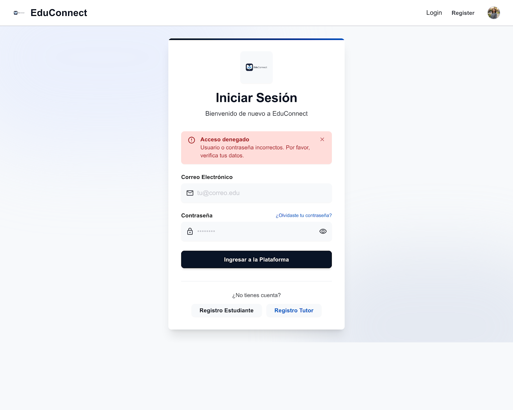


---

#### 3.1.2 Registro de Estudiantes

##### Prototipo en Google Stitch
Para el registro de alumnos se diseñó una interfaz estructurada por secciones:
1. **Información Personal:** Nombres, apellidos, número de carnet universitario, género y fecha de nacimiento.
2. **Datos de Contacto:** Dirección de residencia y número de teléfono.
3. **Credenciales y Seguridad:** Correo electrónico institucional y contraseña con indicador visual de cumplimiento de políticas de seguridad.
4. **Carga de Fotografía:** Componente interactivo para subir el avatar de perfil.

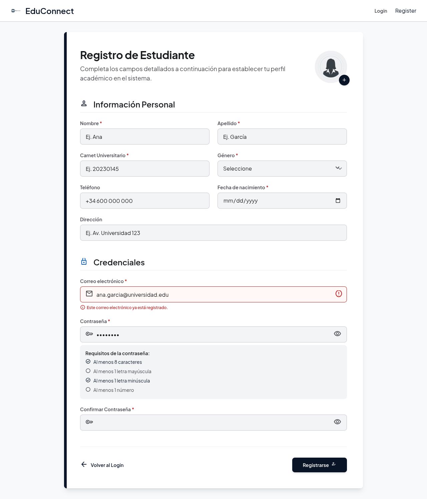

---

#### 3.1.3 Registro de Tutores

##### Prototipo en Google Stitch
El registro de tutores requirió una interfaz de mayor densidad informativa, incorporando:
* Datos personales y número de DPI/Identificación oficial.
* Datos académicos: universidad de graduación, año de inicio como docente/tutor y dirección física del salón de tutoría.
* **Selector Múltiple de Materias de Especialidad:** Tags interactivos que permiten seleccionar una o más cátedras.
* **Horario Inicial de Atención:** Selector de días de la semana y rangos de horas preferenciales.

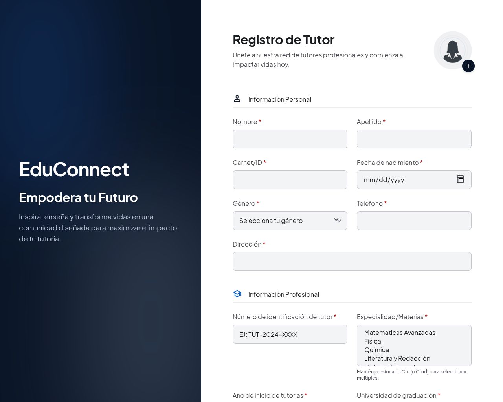


---

#### 3.1.4 Acceso de Administrador: Paso 1 (Credenciales Seguras)

##### Prototipo en Google Stitch
Se diseñó un portal diferenciado para administradores denominado **SecureAccess Portal**, enfocado en sobriedad y seriedad institucional, con validación inmediata de credenciales antes de habilitar el desafío de segundo factor.
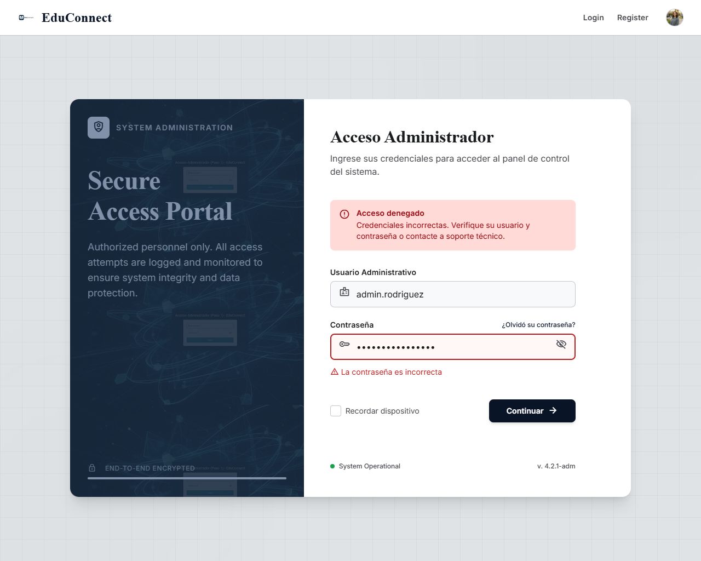


#### 3.1.5 Acceso de Administrador: Paso 2 (2FA Criptográfico con Archivo Físico `auth2-ayd1.txt`)

##### Prototipo en Google Stitch
Para cumplir con el requerimiento de seguridad de la cátedra de Análisis y Diseño de Sistemas 1, el prototipo planteó una zona visual de arrastre (*drag-and-drop*) con icono de escudo y llave digital para subir el archivo de verificación física `auth2-ayd1.txt`.

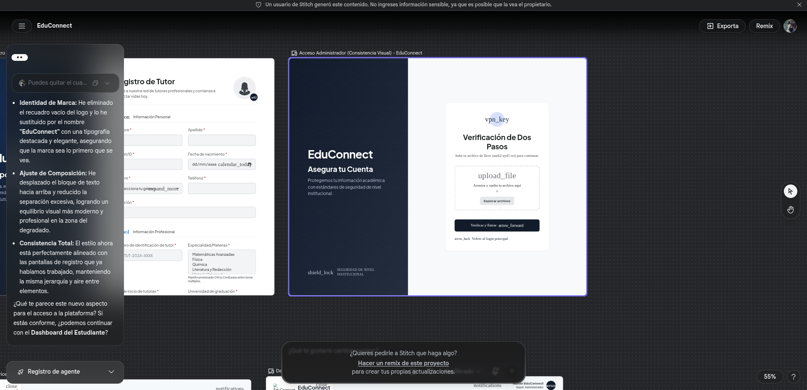

##### B. Implementación Real en Código
La estructura prototipada se implementó de forma modular en `AdminTwoFactorForm.vue` con soporte completo de eventos `dragenter`, `dragover`, `dragleave` y `drop`:

```vue
<div
  :class="[
    'flex flex-col items-center justify-center w-full min-h-[190px] p-6 border-2 border-dashed rounded-xl cursor-pointer transition-all duration-200 text-center',
    isOver && !fileRef
      ? 'border-primary bg-surface-container-high'
      : fileRef
        ? 'border-primary/40 bg-surface-container-low'
        : 'border-outline-variant hover:border-primary/50 bg-surface-container-lowest hover:bg-surface-container-low'
  ]"
  @dragenter.prevent="onDragEnter"
  @dragover.prevent
  @dragleave.prevent="onDragLeave"
  @drop.prevent="onDrop"
  @click="!fileRef && fileInputRef?.click()"
>
  <input
    id="file"
    ref="fileInputRef"
    accept=".txt"
    class="hidden"
    type="file"
    @change="onFileChange"
  />
  <span class="material-symbols-outlined text-4xl text-primary mb-2">upload_file</span>
  <p class="font-semibold text-sm text-on-surface">Arrastra tu archivo auth2-ayd1.txt aquí</p>
</div>
```

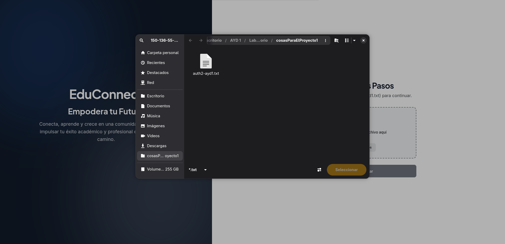

---

#### 3.1.6 Verificación de Seguridad Alternativa (Token de 6 Dígitos)

##### Prototipo en Google Stitch
Adicionalmente, se prototipó una vista de contingencia mediante token numérico de 6 casillas con avance automático de foco (*auto-focus jump*) para verificación en dos pasos estándar.

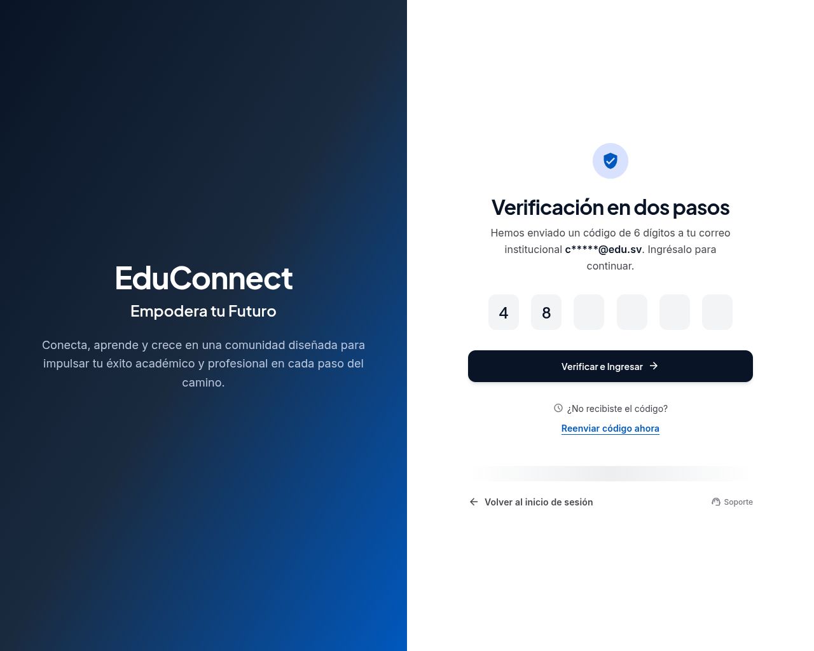


---

### 3.2 Módulo 2: Portal del Estudiante

El portal del estudiante centraliza la búsqueda de tutores calificados, la reserva de citas y el seguimiento académico.

#### 3.2.1 Explorador de Tutores y Filtros Avanzados

##### Prototipo en Google Stitch
Se diseñó un catálogo responsivo compuesto por:
* **Barra lateral de filtros (*Sidebar*):** Con selectores para materia especializada, universidad de procedencia, slider o control de experiencia mínima en años, rango de edad y género.
* **Selector de visualización:** Botones para alternar entre vista de cuadrícula (*grid*) y lista (*list*).
* **Tarjetas de Tutores (*Tutor Cards*):** Con foto de perfil, nombre completo, etiquetas de materias, dirección física de tutoría y botón directo de consulta de disponibilidad.

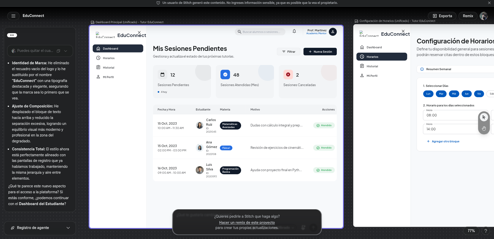

##### B. Implementación Real en Código
Desarrollado mediante `TutorsExplorerView.vue`, `TutorFilterSidebar.vue` y `TutorCard.vue`, utilizando `defineModel` para sincronización bidireccional de filtros reactivos:

```vue
<!-- Enlace de filtros en TutorsExplorerView.vue -->
<script setup lang="ts">
const materia = defineModel<string>('materia', { default: '' })
const universidad = defineModel<string>('universidad', { default: '' })
const expMinima = defineModel<number>('expMinima', { default: 0 })
const rangoEdad = defineModel<number>('rangoEdad', { default: 65 })
const genero = defineModel<'any' | 'female' | 'male'>('genero', { default: 'any' })
</script>
```
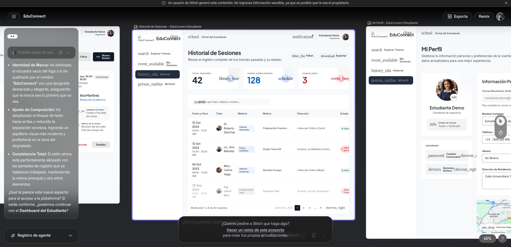

---

#### 3.2.2 Detalle del Tutor y Agendamiento de Sesión (Sin Traslapes)

##### Prototipo en Google Stitch
Para la reserva de citas se prototipó un flujo visual interactivo:
1. Selección de fecha en un calendario mensual.
2. Generación automática de ranuras horarias (*time slots*), coloreando en azul (`secondary`) las horas libres y en gris con línea tachada las ocupadas o fuera del horario laboral del tutor.
3. Formulario flotante de confirmación con materia y motivo de consulta académica.

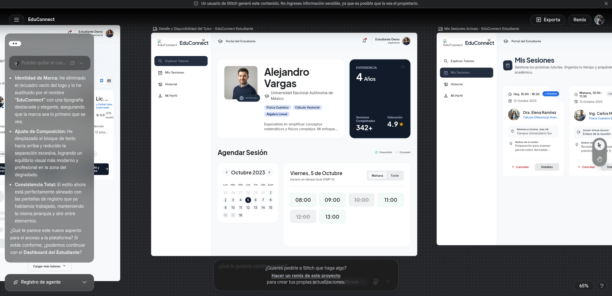

##### B. Implementación Real en Código
Implementado en `SessionBookingView.vue` comunicándose con el endpoint de disponibilidad para impedir traslapes de agenda:

```vue
<!-- Bloques de tiempo disponibles vs ocupados en Vue 3 -->
<div class="grid grid-cols-3 sm:grid-cols-4 gap-2">
  <button
    v-for="bloque in availability.bloques"
    :key="bloque.horaInicio"
    :disabled="!bloque.disponible"
    :class="[
      'rounded-lg py-2 px-1 text-center text-xs font-semibold border transition-all',
      bloque.disponible
        ? 'bg-secondary-fixed/40 text-on-secondary-fixed border-secondary/30 hover:bg-secondary hover:text-white'
        : 'bg-surface-container-high text-on-surface-variant border-outline-variant/30 line-through cursor-not-allowed opacity-60'
    ]"
    @click="selectTimeSlot(bloque.horaInicio)"
  >
    {{ bloque.horaInicio }}
  </button>
</div>
```


---

#### 3.2.3 Mis Sesiones Activas

##### Prototipo en Google Stitch
Vista dedicada al seguimiento de citas vigentes del alumno, con tarjetas que especifican la fecha, hora, nombre del tutor, materia, salón físico y un botón de cancelación con diálogo de confirmación que libera de inmediato el horario en el sistema.

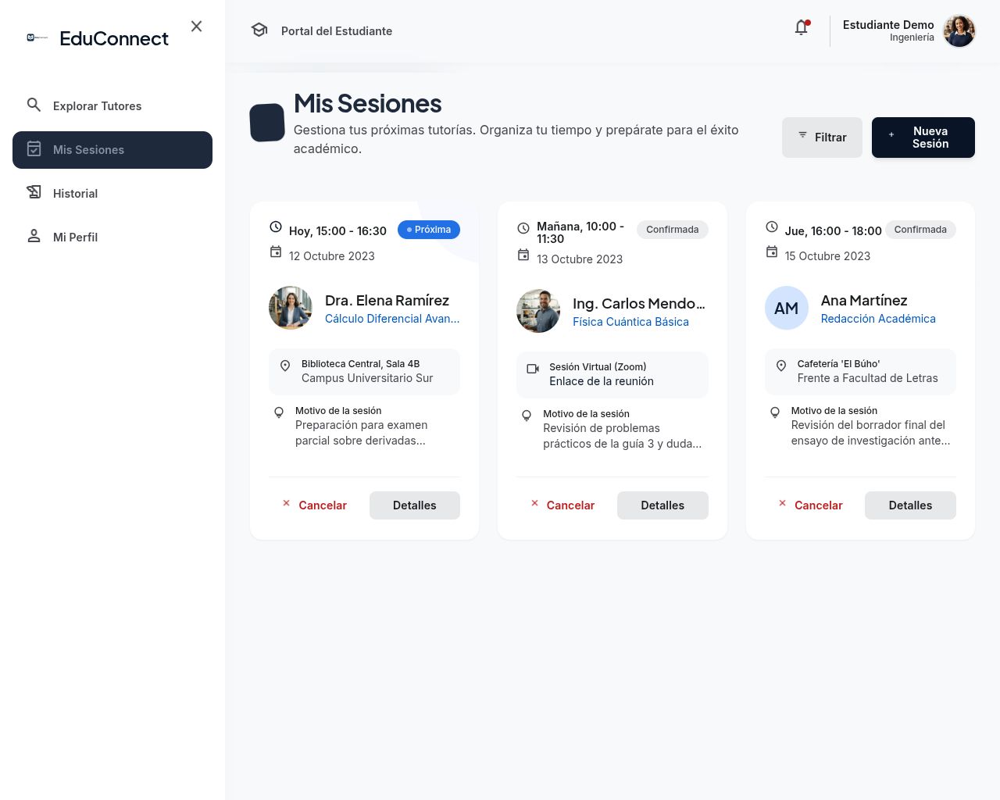

---

#### 3.2.4 Historial de Sesiones del Estudiante

##### Prototipo en Google Stitch
Tabla completa con el registro cronológico de sesiones completadas o canceladas, buscador contextual, filtro por estado y botón para abrir el modal del resumen académico y recomendaciones redactadas por el tutor.

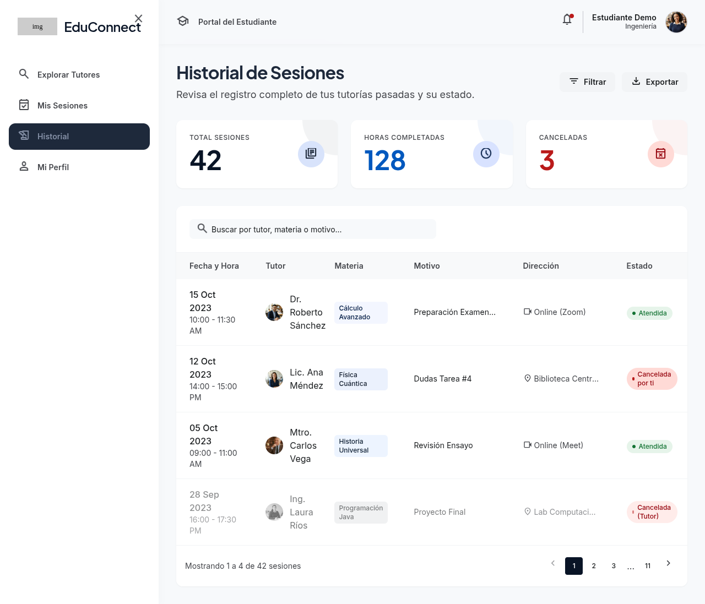

---

#### 3.2.5 Mi Perfil del Estudiante

##### Prototipo en Google Stitch
Diseño de pantalla completa para consultar datos personales, actualizar teléfono y dirección, cambiar la fotografía de perfil y actualizar la contraseña mediante formulario protegido.

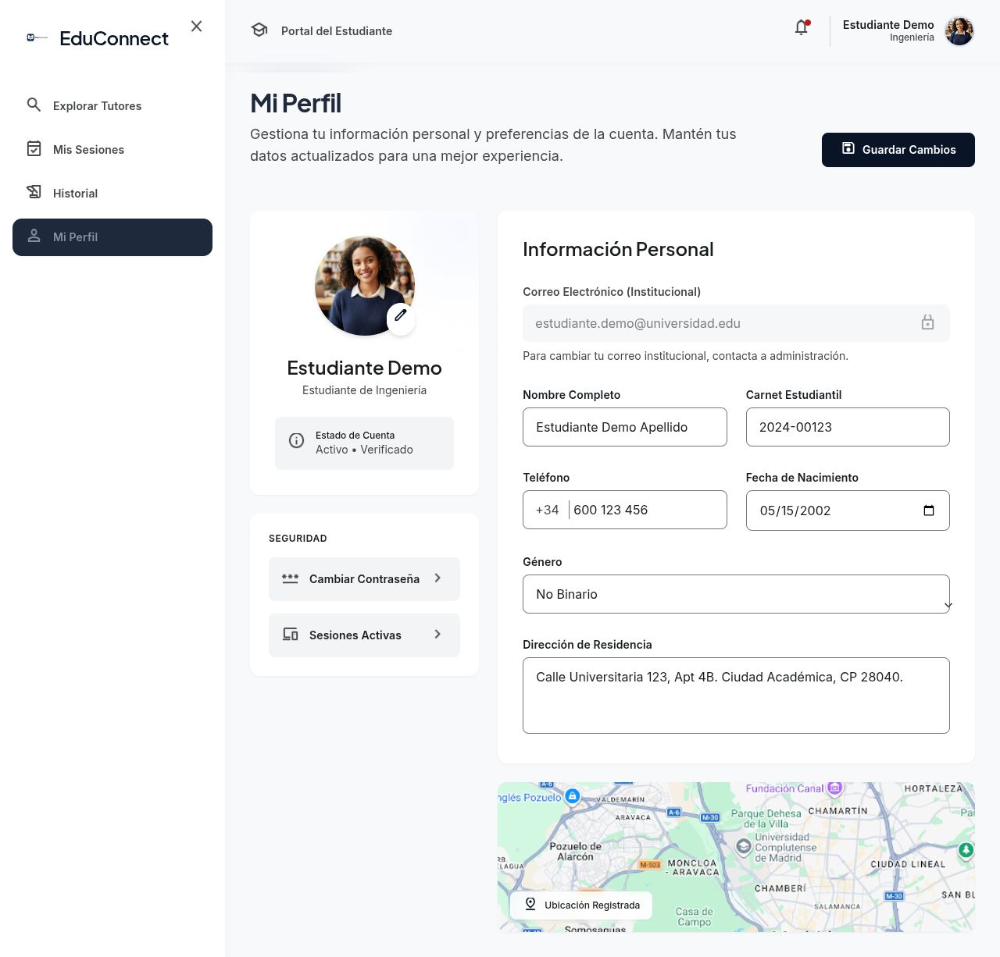

---

### 3.3 Módulo 3: Portal del Tutor

Diseñado con un enfoque operativo y analítico para permitir al tutor gestionar sus horarios y registrar el avance académico de los estudiantes.

#### 3.3.1 Dashboard Operativo y Gestión de Sesiones Pendientes

##### Prototipo en Google Stitch
El dashboard del tutor se diseñó con un enfoque de control rápido:
* **Tarjetas KPIs superiores:** Sesiones Pendientes (con indicador de citas para hoy), Sesiones Atendidas en el Mes y Total de Cancelaciones.
* **Tabla de Sesiones Próximas:** Ordenadas cronológicamente con acciones directas:
  1. **"Marcar como Atendida":** Modal con campo obligatorio para resumen de temas cubiertos y recomendaciones.
  2. **"Cancelar Sesión":** Modal con motivo de cancelación que notifica al alumno.
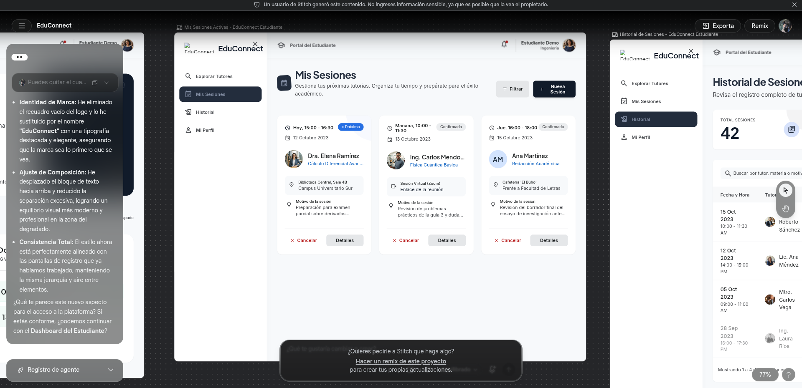


---

#### 3.3.2 Configuración de Horarios y Prevención de Conflictos de Calendario

##### Prototipo en Google Stitch
El prototipo de horarios abordó un problema crítico de usabilidad:
* Selector de días hábiles mediante pastillas activables (Lunes a Domingo).
* Definición de rangos de horas de inicio y fin de atención.
* **Banner de Conflicto de Calendario:** Alerta visual que impide guardar un nuevo rango si existen citas confirmadas que quedarían fuera del nuevo horario, indicando la necesidad de reprogramar.
* **Resumen lateral en tiempo real:** Cálculo automático de total de horas semanales y zona horaria.
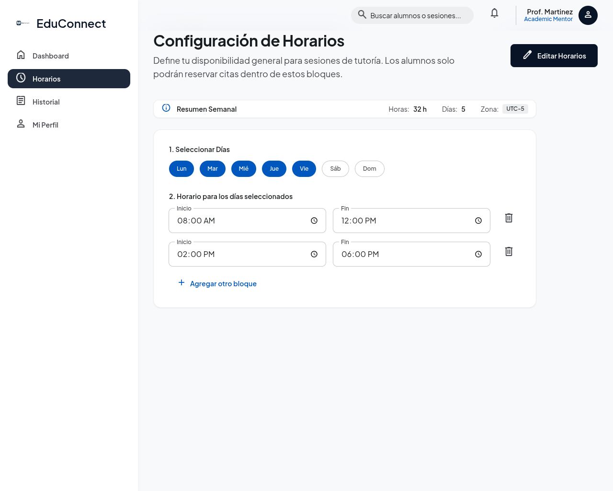
---

#### 3.3.3 Historial de Sesiones del Tutor

##### Prototipo en Google Stitch
Bitácora completa donde el tutor revisa todas las sesiones pasadas, con filtrado por fecha, búsqueda por carnet o nombre del alumno, y consulta rápida de las notas pedagógicas registradas.

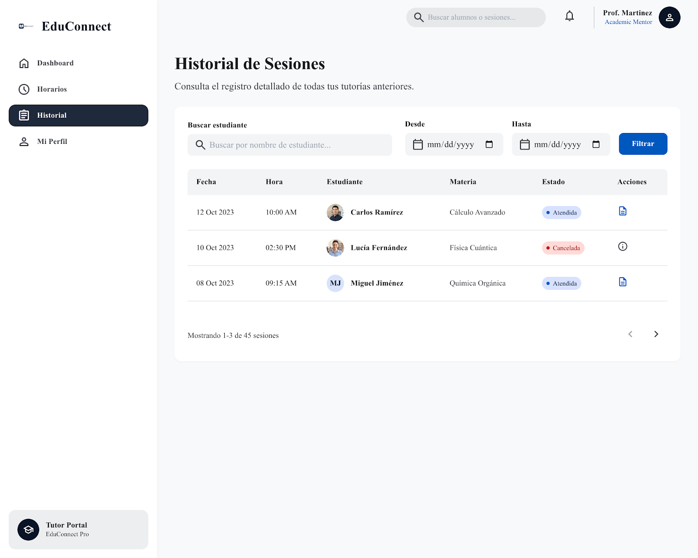
---

#### 3.3.4 Perfil Profesional del Tutor

##### Prototipo en Google Stitch
Formulario integral para modificar salón de tutoría, universidad, materias impartidas, biografía académica y credenciales de acceso.
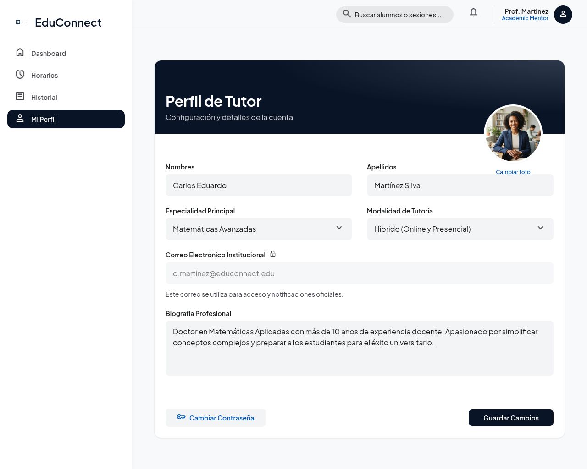

---

### 3.4 Módulo 4: Portal del Administrador

El portal de administración concentra la supervisión de la plataforma, aprobación de cuentas y análisis estadístico.

#### 3.4.1 Dashboard Principal de Control y Auditoría

##### Prototipo en Google Stitch
Diseñado con tarjetas de alto impacto para auditar usuarios activos (Estudiantes y Tutores), sesiones del ciclo lectivo y solicitudes en espera de revisión.
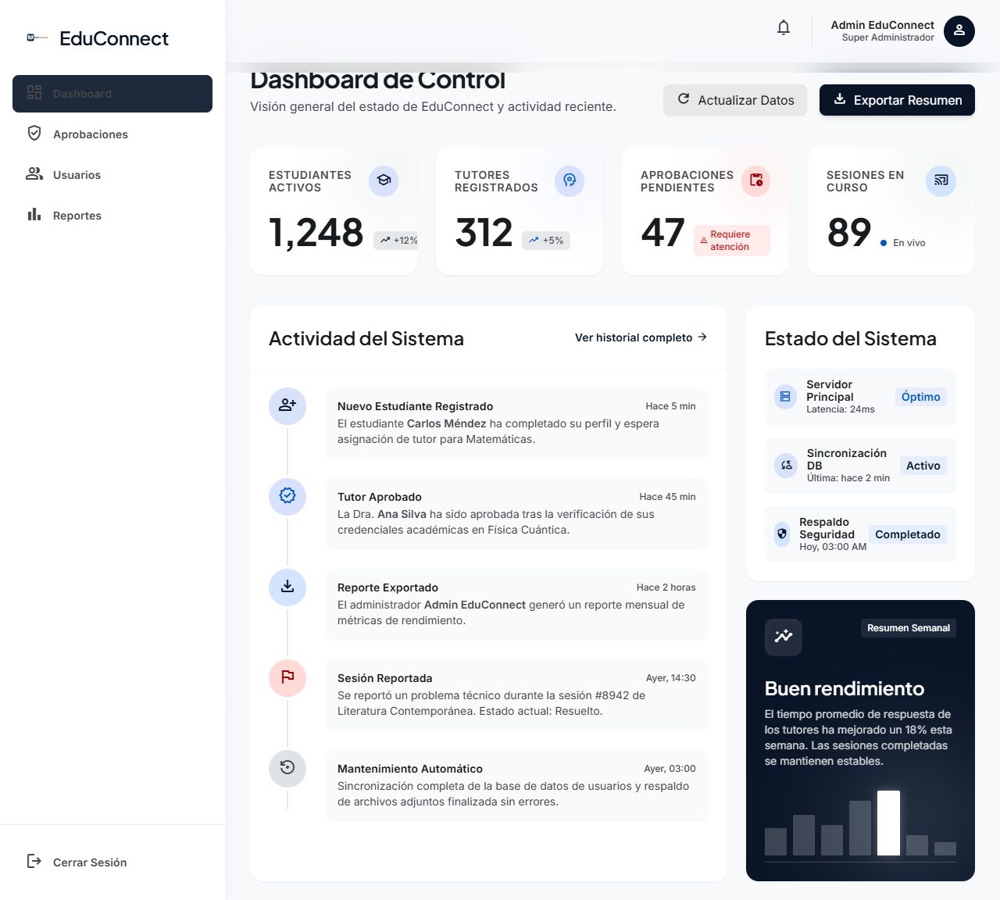

---

#### 3.4.2 Dashboard de Analíticas y Estadísticas Académicas

##### Prototipo en Google Stitch
Diseño de alto nivel analítico que incorpora:
1. **Gráfico de Barras Dinámico:** Ranking de tutores con mayor cantidad de estudiantes atendidos.
2. **Gráfico Circular / Dona SVG:** Demanda porcentual de tutorías agrupadas por materia.
3. **Tablas Analíticas Desglosadas:** Detalle de sesiones atendidas, pendientes y canceladas por asignatura.

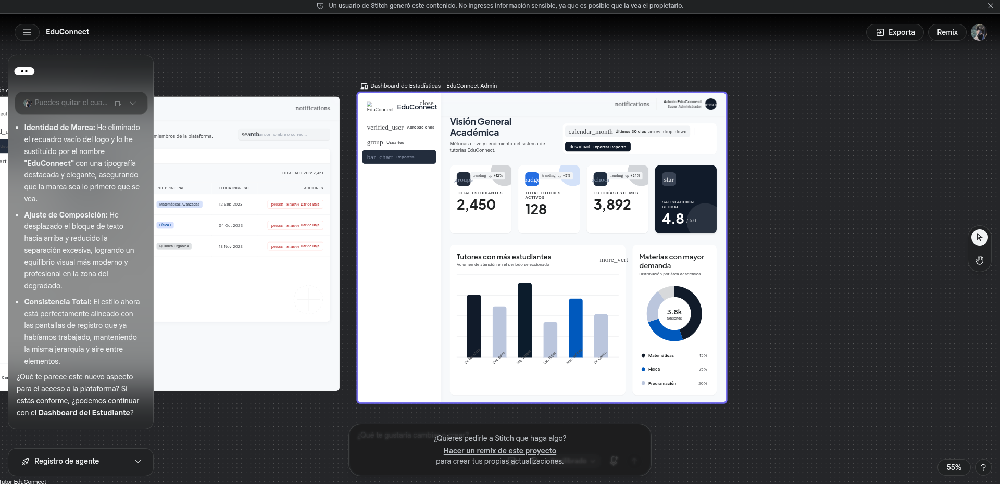

##### B. Implementación Real en Código
Desarrollado en `AdminReportsView.vue` calculando dinámicamente las alturas de las barras en Tailwind y los segmentos de circunferencia SVG mediante `stroke-dasharray`:

```vue
<!-- Gráficos analíticos en AdminReportsView.vue -->
<template>
  <!-- Gráfico de Barras (Tutores más demandados) -->
  <div class="flex items-end gap-3 h-56">
    <div
      v-for="(tutor, idx) in tutoresReport.slice(0, 6)"
      :key="tutor.tutorId"
      :class="getBarColor(idx)"
      :style="{
        height: `${Math.max(12, Math.round((tutor.totalSesionesAtendidas / maxAtencionesTutor) * 88))}%`
      }"
      class="flex-1 rounded-t-lg transition-all flex flex-col justify-end p-2 text-center"
    >
      <span class="text-xs font-bold text-white">{{ tutor.totalSesionesAtendidas }}</span>
    </div>
  </div>

  <!-- Gráfico Dona SVG (Demanda por Materia) -->
  <svg viewBox="0 0 100 100" class="w-40 h-40 transform -rotate-90">
    <circle
      v-for="seg in donutSegments"
      :key="seg.materiaId"
      :class="seg.strokeClass"
      cx="50" cy="50" r="40"
      fill="transparent" stroke-width="20"
      :stroke-dasharray="seg.dashArray"
      :stroke-dashoffset="seg.dashOffset"
    />
  </svg>
</template>
```

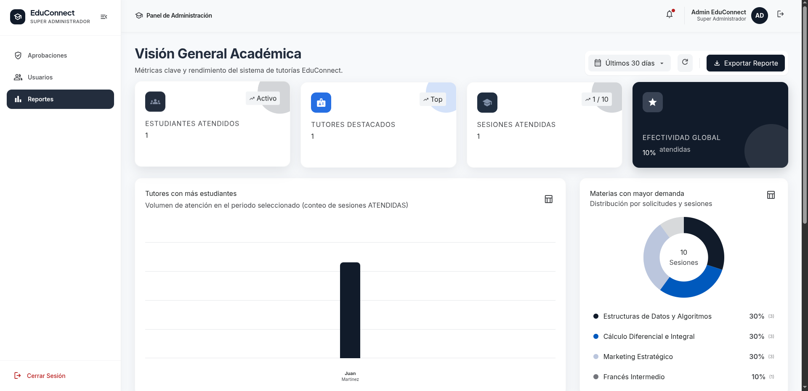

---

#### 3.4.3 Panel de Aprobaciones de Nuevas Cuentas (Estudiantes y Tutores)

##### Prototipo en Google Stitch
Se concibió un centro de control con dos pestañas independientes (*Estudiantes Pendientes* y *Tutores Pendientes*), con contadores numéricos en badges, buscador en vivo y botones rápidos para:
* **Aceptar:** Abre confirmación inmediata y activa la cuenta.
* **Rechazar:** Despliega un modal obligatorio para indicar el motivo de rechazo (ej. carnet ilegible o datos incompletos).

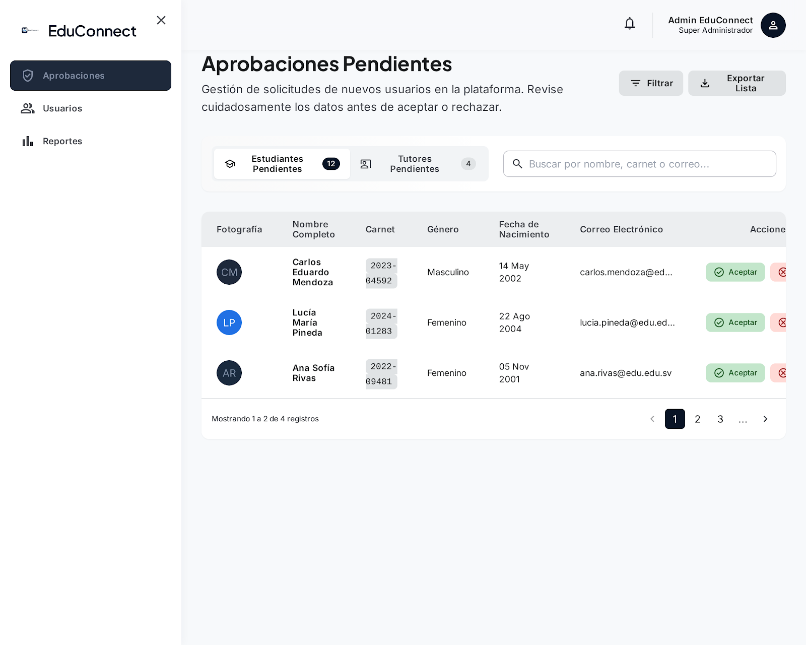

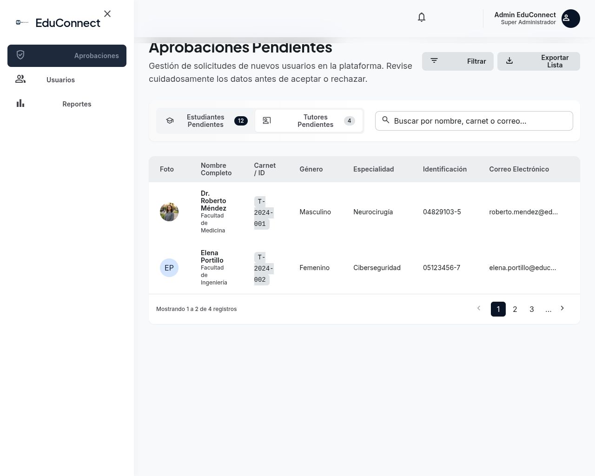


---

#### 3.4.4 Gestión y Baja de Usuarios

##### Prototipo en Google Stitch
Diseñado para la administración del ciclo de vida de los usuarios activos e inactivos:
* Pestañas para conmutar entre *Usuarios Activos* y *Usuarios Dados de Baja*.
* Subfiltros por rol (Estudiante o Tutor).
* Opciones de edición de datos y botón de **"Dar de Baja"** con modal de justificación que desactiva las credenciales sin perder el historial académico.

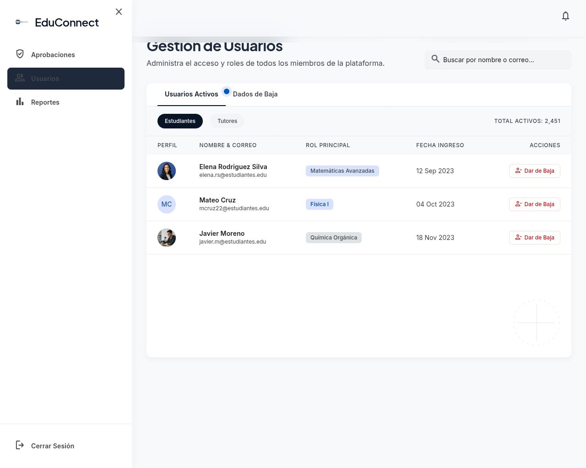

---

## 4. Mapeo de Principios de Usabilidad de Jakob Nielsen

El prototipado en Google Stitch y la subsiguiente implementación en Vue 3 se rigieron formalmente por los **10 Principios Heurísticos de Usabilidad de Jakob Nielsen**:

| Heurística de Usabilidad | Aplicación Concreta en el Prototipo y Frontend de EduConnect |
|---|---|
| **1. Visibilidad del Estado del Sistema** | Badges de color en vivo (`PENDIENTE`, `APROBADO`, `ATENDIDA`, `CANCELADA`), contadores numéricos en pestañas de aprobaciones e indicadores de carga (`isLoading` y animaciones de refresco). |
| **2. Correspondencia entre Sistema y Mundo Real** | Metáforas de calendario mensual para agendamiento, selector de días familiares (Lun, Mar, Mié...), iconografía académica estándar y términos comprensibles. |
| **3. Control y Libertad del Usuario** | Posibilidad de cancelar citas programadas, botones para limpiar todos los filtros aplicados en un solo clic y botones para cerrar modales sin guardar cambios. |
| **4. Consistencia y Estándares** | Tokens visuales unificados de *Academic Modern* en los tres roles, misma disposición de menús laterales (*sidebars*) y comportamiento uniforme en formularios. |
| **5. Prevención de Errores** | Detección automática de conflictos de horario al editar disponibilidad, deshabilitación de ranuras ocupadas con tachado visual y advertencia previa a la confirmación de bajas. |
| **6. Reconocimiento antes que Recuerdo** | Chips visuales que muestran los filtros activos en el explorador de tutores, autocompletado en campos de materias y precarga del horario existente en la configuración del tutor. |
| **7. Flexibilidad y Eficiencia de Uso** | Conmutador de vista cuadrícula/lista según preferencia del alumno, búsqueda instantánea por carnet, nombre o correo y atajos de filtrado rápido. |
| **8. Diseño Estético y Minimalista** | Jerarquía visual clara, eliminación de datos redundantes, márgenes estructurados (`32px` desktop / `24px` gutter) y fondos neutros (`#F7F9FB`) de alto contraste. |
| **9. Ayuda a Reconocer, Diagnosticar y Recuperar Errores** | Alertas en línea con mensajes contextuales específicos (ej. *"Las contraseñas no coinciden"* o *"La sesión genera conflicto con una cita agendada"*). |
| **10. Ayuda y Documentación** | Textos explicativos en cada encabezado de pantalla, descripciones de requisitos en campos complejos y tooltips informativos en badges y acciones. |

---

## 5. Matriz de Trazabilidad: Requerimientos Funcionales (RFs) vs. Prototipos Stitch

| ID Requerimiento | Requerimiento Funcional | Pantalla Prototipada en Google Stitch | Componente en Vue 3 |
|---|---|---|---|
| **RF-01** | Inicio de Sesión y Autenticación | `iniciar_sesi_n_unificado_educonnect` | `LoginForm.vue`, `AuthLayout.vue` |
| **RF-02** | Registro de Estudiantes | `registro_de_estudiante_unificado_educonnect` | `StudentRegisterForm.vue` |
| **RF-03** | Registro de Tutores y Materias | `registro_de_tutor_consistencia_visual_educonnect` | `TutorRegisterForm.vue` |
| **RF-04** | Acceso Administrador y 2FA Físico | `acceso_administrador_2fa_llave_layout_moderno` | `AdminTwoFactorForm.vue` |
| **RF-05** | Aprobación de Estudiantes | `panel_de_aprobaciones_estudiantes_educonnect_admin` | `AdminApprovalsStudentList.vue` |
| **RF-06** | Aprobación de Tutores | `panel_de_aprobaciones_tutores_educonnect_admin_2` | `AdminApprovalsTutorList.vue` |
| **RF-07** | Explorador y Filtros de Tutores | `explorador_de_tutores_educonnect_estudiante_2` | `TutorsExplorerView.vue` |
| **RF-08** | Disponibilidad y Agendamiento de Citas | `detalle_y_disponibilidad_del_tutor_educonnect_estudiante` | `SessionBookingView.vue` |
| **RF-09** | Gestión de Citas del Estudiante | `mis_sesiones_activas_educonnect_estudiante` | `StudentSessionsView.vue` |
| **RF-10** | Historial y Calificación de Tutorías | `historial_de_sesiones_educonnect_estudiante` | `StudentHistoryView.vue` |
| **RF-11** | Dashboard Operativo del Tutor | `dashboard_principal_unificado_tutor_educonnect` | `TutorDashboardView.vue` |
| **RF-12** | Atención y Resumen Académico de Sesión | `dashboard_principal_unificado_tutor_educonnect` | `CompleteSessionModal.vue` |
| **RF-13** | Configuración de Horarios del Tutor | `configuraci_n_de_horarios_unificado_tutor_educonnect_2` | `TutorScheduleView.vue` |
| **RF-14** | Historial de Tutorías del Tutor | `historial_de_sesiones_unificado_tutor_educonnect_2` | `TutorHistoryView.vue` |
| **RF-15** | Estadísticas y Reportes de Rendimiento | `dashboard_de_estad_sticas_educonnect_admin` | `AdminReportsView.vue` |
| **RF-16** | Gestión y Baja de Usuarios | `gesti_n_de_usuarios_educonnect_admin` | `AdminUsersManagementView.vue` |
| **RF-17** | Gestión de Perfil de Usuario | `mi_perfil_educonnect_estudiante` / `mi_perfil_unificado_tutor` | `ProfileView.vue` |

---

## 6. Conclusiones y Lecciones Aprendidas con Google Stitch

1. **Alineación Multidisciplinaria sin Ambigüedades:** La suite de prototipos de Google Stitch permitió al equipo de 6 integrantes alinear criterios de diseño, flujos de usuario y reglas de validación antes de abrir un solo pull request en GitHub, disminuyendo sustancialmente el retrabajo durante los Sprints.
2. **Puente Directo entre Diseño y Código:** Al generar código semántico con clases de Tailwind CSS bajo el tema *Academic Modern*, la traducción visual hacia componentes modulares de Vue 3 (`<script setup lang="ts">`) fue casi inmediata, respetando estrictamente la exigencia de no recurrir a plantillas prefabricadas.
3. **Validación Temprana de Heurísticas de Usabilidad:** Las simulaciones interactivas en Stitch permitieron detectar a tiempo fricciones en la experiencia de usuario (tales como la claridad de las ranuras de tiempo disponibles versus ocupadas y la necesidad de confirmación explícita con motivo antes de rechazar una solicitud o cancelar una sesión).
4. **Diseño Responsivo Nativo:** El prototipado contempló el comportamiento adaptativo de barras de navegación colapsables (*sidebars*), tablas deslizables y formularios divididos tanto en pantallas móviles como de escritorio.
