# Gestión Ágil del Proyecto: Tablero Kanban, Evidencias y Evaluación Scrum — EduConnect

**Universidad de San Carlos de Guatemala (USAC)**  
**Facultad de Ingeniería — Escuela de Ciencias y Sistemas**  
**Análisis y Diseño de Sistemas 1 (AYD1) — Segundo Semestre 2026**  
**Grupo 7**

---

### Resumen del Documento
Este documento consolida la gestión ágil del proyecto **EduConnect**, unificando y documentando de forma estructurada e independiente la **Fase 1** (Sprints 1 y 2) y la **Fase 2** (Sprints 1 y 2 / Sprints 3 y 4 globales). Incluye:
1. **Link oficial de la herramienta de gestión de proyectos (Jira Software)** y configuración del flujo Kanban.
2. **Capturas de seguimiento del Tablero Kanban** a lo largo de cada Sprint (mínimo 3 capturas obligatorias: inicio, desarrollo intermedio y finalización).
3. **Registro completo y ordenado de las grabaciones de video** de las ceremonias ágiles (Sprint Planning y Sprint Retrospective).
4. **Documentación detallada de las reuniones Daily Scrum** con registro cronológico de los 6 integrantes y comentarios/espacios de captura diaria.
5. **Sección oficial del Scrum Master para la calificación del equipo de desarrollo** en escala de 1 a 100 puntos con métricas cuantitativas, análisis de aportes y justificaciones individuales.

---

### Información General del Equipo y Enlaces de Gestión

* **Herramienta de Gestión Ágil:** Jira Software Cloud (Atlassian)
* **URL del Tablero Público/Compartido en Jira:**  
  [https://edu-connect-g7.atlassian.net/?continue=https%3A%2F%2Fedu-connect-g7.atlassian.net%2Fwelcome%2Fsoftware%3FprojectId%3D10000&atlOrigin=eyJpIjoiZDI4NjFkNjZlMDg2NDU4NTkwODAyZTU3MDE](https://edu-connect-g7.atlassian.net/?continue=https%3A%2F%2Fedu-connect-g7.atlassian.net%2Fwelcome%2Fsoftware%3FprojectId%3D10000&atlOrigin=eyJpIjoiZDI4NjFkNjZlMDg2NDU4NTkwODAyZTU3MDE)
* **Enlace de Reuniones Virtuales (Google Meet):**  
  [https://meet.google.com/bxn-iweb-mby](https://meet.google.com/bxn-iweb-mby)
* **Prototipo Interactivo en Google Stitch:**  
  [https://stitch.withgoogle.com/projects/11044310364948617047](https://stitch.withgoogle.com/projects/11044310364948617047)

### Roles del Equipo
| Nombre Completo | Carnet | Rol Principal Asignado |
| :--- | :---: | :---: |
| **Carlos Eduardo Lau López** | 202202812 | **Scrum Master** / Desarrollador Backend & Frontend |
| **Eduardo Sebastián Gutiérrez Felipe** | 202300694 | **Product Owner** / Desarrollador Full-Stack |
| **Christian David Chinchilla Santos** | 202308227 | Equipo de Desarrollo (Backend & QA) |
| **Josue Daniel Revolorio Martinez** | 202102984 | Equipo de Desarrollo (Frontend & Reportes) |
| **Sebastian Antonio Romero Tzitzimit** | 202201690 | Equipo de Desarrollo (Full-Stack & Seguridad) |
| **Keitlyn Valentina Tunchez Castañeda** | 202201139 | Equipo de Desarrollo (Frontend & Validaciones) |

---

## 1. Configuración del Tablero Kanban en Jira Software

El flujo de trabajo técnico del equipo se implementó respetando rigurosamente las **5 columnas estándar solicitadas en el enunciado del curso**, modelando el ciclo de vida continuo de cada Historia de Usuario (*issue*) y subtarea técnica:

```
┌─────────────┐     ┌─────────────┐     ┌─────────────┐     ┌─────────────┐     ┌─────────────┐
│    TO-DO    │ ──► │   BLOCKED   │ ──► │ IN PROGRESS │ ──► │   TEST/QA   │ ──► │   DEPLOY    │
│             │     │ (Bloqueado) │     │ (En Curso)  │     │(Validación) │     │(Completado) │
└─────────────┘     └─────────────┘     └─────────────┘     └─────────────┘     └─────────────┘
```

### 1.1 Definición de Columnas y Políticas Explícitas

1. **`TO-DO` (Por Hacer):**
   - Aloja las Historias de Usuario priorizadas por el Product Owner y estimadas en Story Points durante la sesión de Sprint Planning.
   - **Criterio de Entrada (Definition of Ready - DoR):** Requerimiento sin ambigüedades, criterios de aceptación en formato Gherkin/Given-When-Then, dependencias técnicas identificadas y esfuerzo acordado con Planning Poker.

2. **`BLOCKED` (Bloqueado / Impedimento):**
   - Destinado a visibilizar cuellos de botella técnicos de forma inmediata (fallas en contenedores Docker, dudas de lógica de negocio o bloqueo por dependencias de otro compañero).
   - **Regla del Scrum Master:** Cualquier tarjeta movida a `BLOCKED` se trata como prioridad máxima en la siguiente Daily Scrum para despejar el camino del desarrollador.

3. **`IN PROGRESS` (En Curso / Desarrollo Activo):**
   - Tareas en codificación activa. Se trabaja bajo ramas Git Flow con convención `feature/carnet` y commits asociados al código de Jira (ej. `[ED-121] Implementar endpoint...`).
   - **Límite de Trabajo en Curso (WIP Limit):** Máximo 2 tareas activas por integrante para maximizar el rendimiento y evitar la multitarea ineficiente.

4. **`TEST/QA` (Control de Calidad y Pruebas):**
   - Tareas cuya codificación finalizó y se encuentran en revisión por pares (*code review*), pruebas unitarias/E2E o validación en Postman/navegador.
   - Requiere aprobación cruzada de un segundo desarrollador antes de autorizar el merge a la rama principal de integración (`develop` / `main`).

5. **`DEPLOY` (Desplegado / Terminado):**
   - Tareas completamente integradas, probadas y funcionales en el entorno local multi-contenedor (Frontend en Vue 3, Backend en .NET 10 y BD en Oracle XE).
   - **Criterio de Salida (Definition of Done - DoD):** Código sin warnings de linter, endpoints documentados, tests unitarios superados y contenedor reconstruido exitosamente sin regresiones.

---

## 2. FASE 1: Tablero Kanban, Evidencias y Ceremonias (Sprints 1 y 2)

Durante la primera fase del proyecto se construyeron los cimientos arquitectónicos, la autenticación multifactor y el ciclo de vida base de tutorías en EduConnect.

### 2.1 Sprint 1 (Fase 1): Fundaciones, Autenticación y Reserva Base
* **Período:** 28 de agosto al 3 de septiembre de 2026 (7 días)
* **Alcance:** 10 Historias de Usuario (HU-01 a HU-06, HU-10, HU-16 a HU-18) — **59 Story Points**.

#### A. Inicio del Sprint 1 (Fase 1)
* **Fecha:** 28 de agosto de 2026.
* **Descripción:** Tablero Kanban recién configurado tras la sesión de Sprint Planning 1. Las 10 historias de usuario y sus subtareas técnicas de backend, frontend y base de datos se encuentran cargadas en la columna `TO-DO`.

<!-- [IMAGEN: Captura del Tablero Kanban al inicio del Sprint 1 - Fase 1] -->
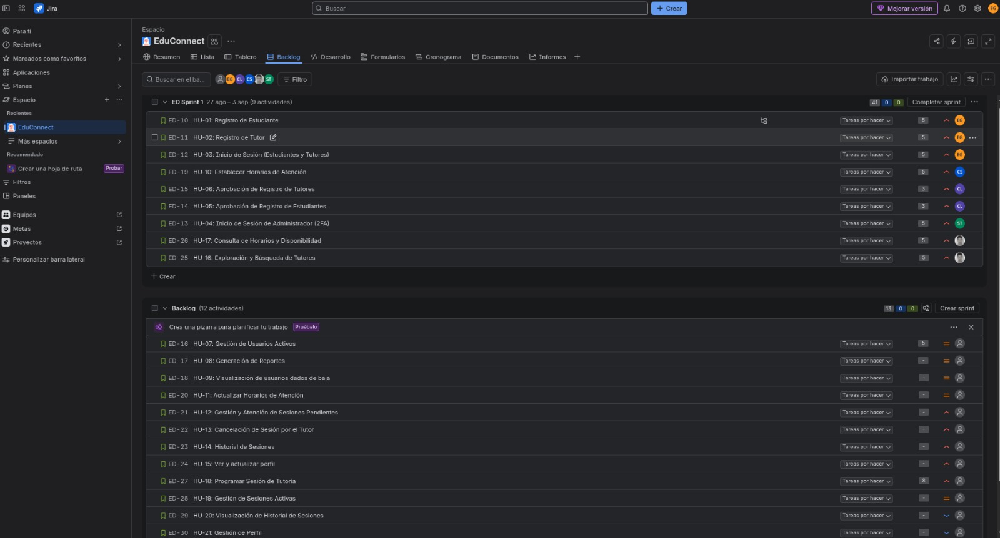

---

#### B. Durante el Desarrollo del Sprint 1 (Fase 1)
* **Fecha:** 31 de agosto de 2026 (Mitad de iteración).
* **Descripción:** Se observa el flujo dinámico de trabajo: registro de tutores, endpoints de Minimal APIs y maquetación en Vue 3 en la columna `IN PROGRESS`, validación de 2FA y revisión de código en `TEST/QA`, y resolución activa de bloqueos temporales.

<!-- [IMAGEN: Captura del Tablero Kanban a mitad del Sprint 1 - Fase 1] -->
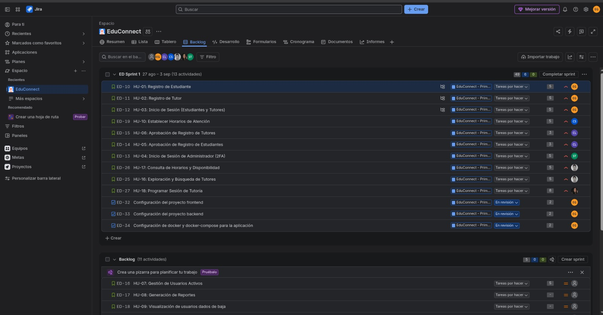

---

#### C. Fin del Sprint 1 (Fase 1)
* **Fecha:** 3 de septiembre de 2026 (Cierre de iteración).
* **Descripción:** Cierre exitoso del Sprint 1 con el 100% de los 59 Story Points completados y validados en la columna `DEPLOY`, garantizando el registro de estudiantes/tutores, el inicio de sesión con 2FA y la reserva base.

<!-- [IMAGEN: Captura del Tablero Kanban al final del Sprint 1 - Fase 1] -->
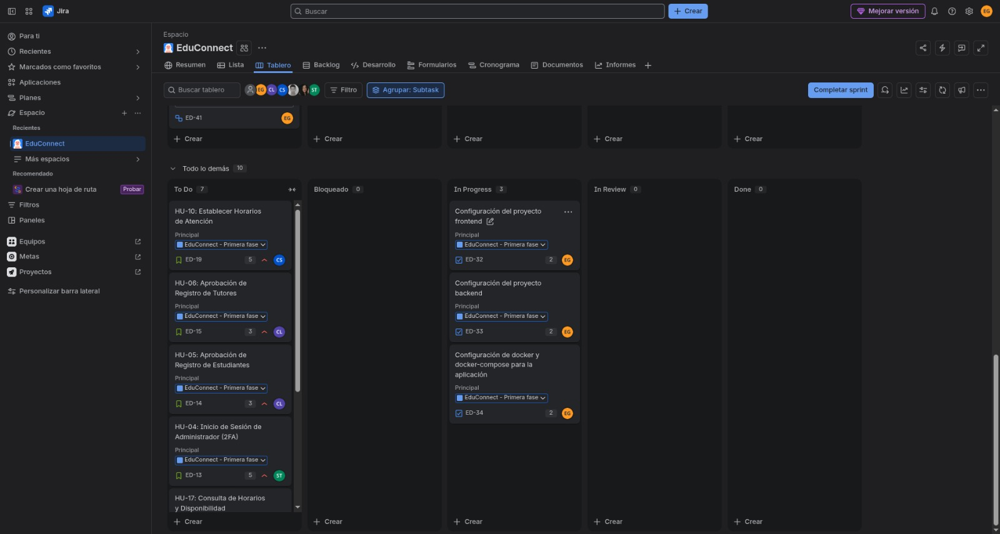

---

### 2.2 Sprint 2 (Fase 1): Gestión Activa, Cancelaciones, Bajas, Reportes y Perfiles
* **Período:** 6 de septiembre al 13 de septiembre de 2026 (8 días)
* **Alcance:** 11 Historias de Usuario (HU-07 a HU-09, HU-11 a HU-15, HU-19 a HU-21) — **47 Story Points**.

#### A. Inicio del Sprint 2 (Fase 1)
* **Fecha:** 6 de septiembre de 2026.
* **Descripción:** Inicio del segundo ciclo de trabajo con las 11 historias restantes del Product Backlog cargadas y asignadas en la columna `TO-DO` tras la sesión de Sprint Planning 2.

<!-- [IMAGEN: Captura del Tablero Kanban al inicio del Sprint 2 - Fase 1] -->
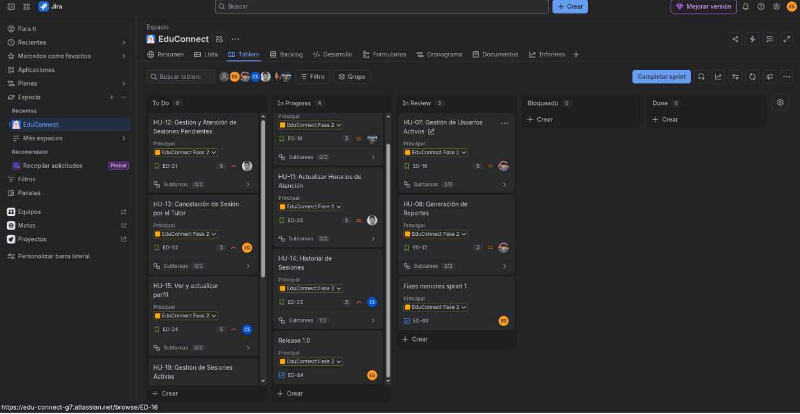

---

#### B. Durante el Desarrollo del Sprint 2 (Fase 1)
* **Fecha:** 9 de septiembre de 2026 (Mitad de iteración).
* **Descripción:** El equipo trabajando en paralelo en los módulos de cancelaciones con correo SMTP, auditoría de bajas, reportería gráfica con Chart.js y actualización de perfiles con fotos en AWS S3 en columnas `IN PROGRESS` y `TEST/QA`.

<!-- [IMAGEN: Captura del Tablero Kanban a mitad del Sprint 2 - Fase 1] -->
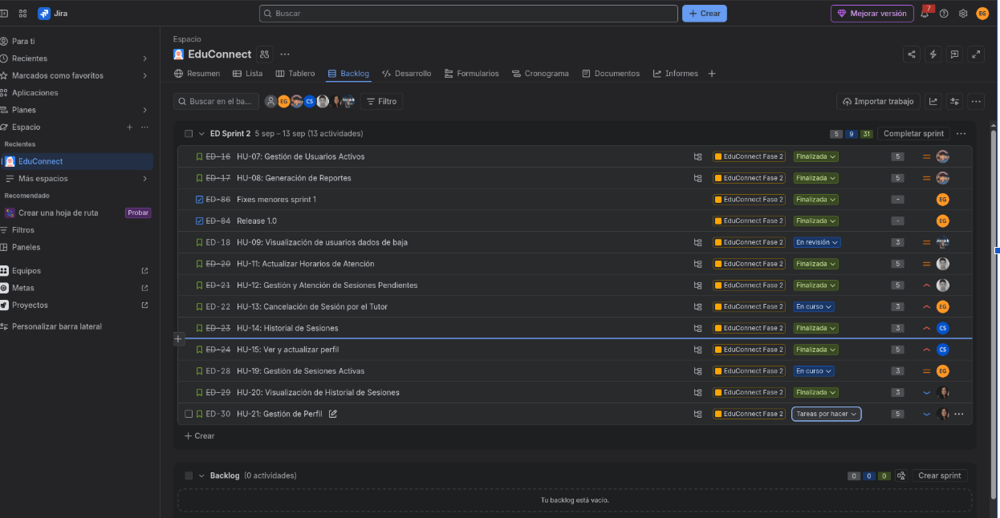

---

#### C. Fin del Sprint 2 (Fase 1)
* **Fecha:** 13 de septiembre de 2026 (Cierre de Fase 1).
* **Descripción:** Cumplimiento total del alcance de la Fase 1. El 100% de las tareas han pasado a `DEPLOY` y el release 1.0 queda completamente operativo.

<!-- [IMAGEN: Captura del Tablero Kanban al final del Sprint 2 - Fase 1] -->
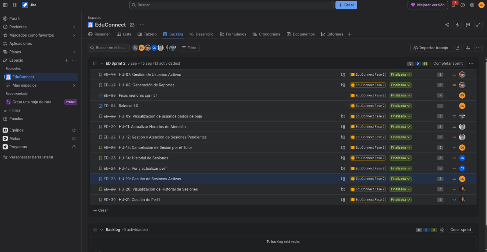

---

### 2.3 Registro de Grabaciones de Ceremonias Scrum (Fase 1)

| Evento Scrum | Fecha de Grabación | Duración Estimada | Plataforma | Enlace Oficial a la Grabación en Google Drive |
| :--- | :---: | :---: | :---: | :--- |
| **Sprint Planning 1 (Fase 1)** | 28 de agosto de 2026 | 45 min | Google Drive | [Ver Grabación Planning 1](https://drive.google.com/file/d/1ri4orJFaydUjhzw5CqiIwb76Mna0RGkg/view?usp=drive_link) |
| **Sprint Retrospective 1 (Fase 1)** | 3 de septiembre de 2026 | 30 min | Google Drive | [Ver Grabación Retrospective 1](https://drive.google.com/file/d/1_vpaSY4U2ffFfP7xb4tgmE0YvEiARGTP/view?usp=drive_link) |
| **Sprint Planning 2 (Fase 1)** | 6 de septiembre de 2026 | 40 min | Google Drive | [Ver Grabación Planning 2](https://drive.google.com/file/d/1beKELHINHqWvxiWkoaeZViC2a6F17LKB/view?usp=drive_link) |
| **Sprint Retrospective 2 (Fase 1)** | 13 de septiembre de 2026 | 35 min | Google Drive | [Ver Grabación Retrospective 2](https://drive.google.com/file/d/1cs33HjPimm_d2zusLpagXPFDeMIj5nEp/view?usp=drive_link) |

---

### 2.4 Documentación de Daily Scrums (Fase 1)
El equipo documentó íntegramente las minutas de sincronización diaria de 15 minutos respondiendo a las tres preguntas clave: *¿Qué hice ayer?*, *¿Qué voy a hacer hoy?*, *¿Tengo algún impedimento?*.

* **Detalle completo de Dailies del Sprint 1 (Fase 1):** [Ver Documento de Dailies Sprint 1](../../scrum/sprint-1/sprint-dailies.md)
* **Detalle completo de Dailies del Sprint 2 (Fase 1):** [Ver Documento de Dailies Sprint 2](../../scrum/sprint-2/sprint-dailies.md)

---

### 2.5 Evaluación del Desempeño del Equipo por el Scrum Master (Fase 1)

Evaluación realizada por el Scrum Master (**Carlos Eduardo Lau López**) analizando commits, líneas agregadas/eliminadas y cumplimiento en un rango de 1 a 100 puntos:

| Integrante | Carnet | Commits F1 | Líneas (+) | Líneas (-) | Nota S1 | Nota S2 | Promedio Fase 1 |
|---|:---:|:---:|:---:|:---:|:---:|:---:|:---:|
| **Eduardo Sebastian Gutierrez Felipe** | 202300694 | 75 | 20,752 | 2,510 | 100 | 100 | **100** |
| **Carlos Eduardo Lau López** | 202202812 | 17 | 10,414 | 685 | 95 | 100 | **98** |
| **Christian David Chinchilla Santos** | 202308227 | 10 | 3,130 | 95 | 90 | 95 | **93** |
| **Sebastian Antonio Romero Tzitzimit** | 202201690 | 12 | 2,789 | 313 | 90 | 95 | **93** |
| **Keitlyn Valentina Tunchez Castañeda** | 202201139 | 6 | 2,994 | 46 | 80 | 90 | **85** |
| **Josue Daniel Revolorio Martínez** | 202102984 | 12 | 1,343 | 303 | 80 | 85 | **83** |

* **Justificación General:** Destacado liderazgo técnico de Eduardo Gutiérrez en configuración base y 2FA; Carlos Lau coordinó eficientemente las ceremonias y resolvió módulos complejos; Christian y Sebastián mantuvieron un ritmo ascendente; Keitlyn y Josue iniciaron con demoras en Sprint 1 pero repuntaron notablemente en Sprint 2 logrando un cierre limpio.

---

## 3. FASE 2: Tablero Kanban, Evidencias y Ceremonias (Sprints 1 y 2)

En la segunda fase se incorporaron requerimientos avanzados de auditoría documental (visores PDF incrustados), verificación criptográfica con tokens OTP por correo, constancias pedagógicas en PDF, calificaciones bidireccionales y reportería analítica ejecutiva.

### 3.1 Sprint 1 (Fase 2): Identidad, Verificación, Visores PDF y Planes de Estudio
* **Período de Ejecución:** 28 de septiembre al 3 de octubre de 2026 (6 días intensivos).
* **Historias de Usuario Asignadas (38 Story Points):**
  - **HU-22 (5 SP):** Registro de estudiante con foto y carnet en PDF (Keitlyn Tunchez).
  - **HU-23 (3 SP):** Registro de tutor con CV en PDF obligatorio (Keitlyn Tunchez).
  - **HU-24 (5 SP):** Verificación de cuenta con código de 6 dígitos enviado por correo (Eduardo Gutiérrez / ED-120, ED-121, ED-122).
  - **HU-25 (5 SP):** Vista interactiva del Plan de Estudio del estudiante (Josue Revolorio).
  - **HU-26 (5 SP):** Generación e impresión institucional de Plan de Estudio en PDF (Josue Revolorio).
  - **HU-32 (5 SP):** Aprobación administrativa de estudiantes con visor PDF incrustado (Christian Chinchilla).
  - **HU-33 (5 SP):** Aprobación administrativa de tutores con visor PDF incrustado del CV (Sebastian Romero / Christian Chinchilla).
  - **HU-35 (5 SP):** Módulo administrativo de actualización y baja de tutores (Carlos Lau).

#### A. Inicio del Sprint 1 (Fase 2)
* **Fecha:** 28 de septiembre de 2026.
* **Descripción:** Tablero Kanban recién inicializado en Jira para la Fase 2. Las 8 nuevas historias (HU-22 a HU-26, HU-32, HU-33, HU-35) y sus subtareas técnicas asociadas se encuentran cargadas en la columna `TO-DO`.

<!-- [ESPACIO PARA CAPTURA: Tablero Kanban Jira - Inicio del Sprint 1 (Fase 2) - 28 de septiembre] -->
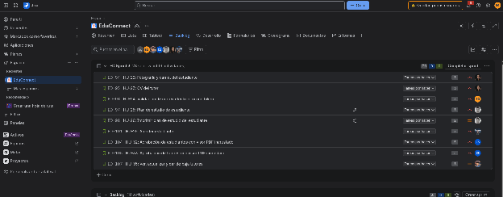

---

#### B. Durante el Desarrollo del Sprint 1 (Fase 2)
* **Fecha:** 1 de octubre de 2026 (Mitad de iteración).
* **Descripción:** Avance acelerado del equipo. Se aprecian tareas en curso en la columna `IN PROGRESS` (backend multipart para carnet/CV, endpoints de token OTP, vista del visor PDF incrustado), tarjetas en validación en `TEST/QA` y tarjetas preliminares en To-Do.

<!-- [ESPACIO PARA CAPTURA: Tablero Kanban Jira - Desarrollo Activo del Sprint 1 (Fase 2) - 1 de octubre] -->
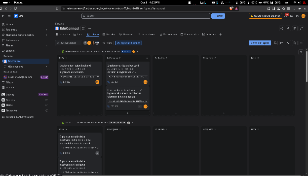

---

#### C. Fin del Sprint 1 (Fase 2)
* **Fecha:** 3 de octubre de 2026 (Cierre de iteración).
* **Descripción:** Culminación exitosa del primer sprint de la Fase 2. La totalidad de las 8 historias de usuario y sus tareas técnicas han sido integradas, probadas con éxito y movidas a la columna `DEPLOY` (Finalizada).

<!-- [ESPACIO PARA CAPTURA: Tablero Kanban Jira - Cierre y Finalización del Sprint 1 (Fase 2) - 3 de octubre] -->
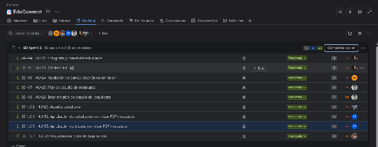

---

### 3.2 Sprint 2 (Fase 2): Calificaciones, Denuncias, Reportería Avanzada y Release Final
* **Período de Ejecución:** 5 de octubre al 10 de octubre de 2026 (6 días intensivos).
* **Historias de Usuario Asignadas (48 Story Points):**
  - **HU-27 (5 SP):** Calificación y reseñas de tutor por parte del estudiante (Sebastian Romero).
  - **HU-28 (5 SP):** Reporte de incidencias y quejas contra tutores (Keitlyn Tunchez).
  - **HU-30 (5 SP):** Calificación pedagógica de estudiante por tutor de 0 a 5 estrellas (Josue Revolorio).
  - **HU-31 (5 SP):** Reporte de estudiantes problemáticos con categorización de faltas (Josue Revolorio).
  - **HU-34 (5 SP):** Módulo administrativo de actualización y baja de estudiantes (Carlos Lau).
  - **HU-36 (5 SP):** Gestión, resolución y sanciones administrativas a tutores reportados (Christian Chinchilla).
  - **HU-37 (5 SP):** Gestión, resolución y baja de estudiantes reportados (Christian Chinchilla).
  - **HU-38 (5 SP):** Reporte gerencial consolidado de calificaciones de tutores (Keitlyn Tunchez).
  - **HU-39 (5 SP):** Reporte gerencial consolidado de calificaciones de estudiantes (Carlos Lau).
  - **HU-40 (8 SP):** Reportería analítica avanzada (Top 10 estudiantes con más sesiones, materias con mayor tasa de cancelación, ratio asistencia vs cancelación) (Eduardo Gutiérrez / ED-150 a ED-157).

#### A. Inicio del Sprint 2 (Fase 2)
* **Fecha:** 5 de octubre de 2026.
* **Descripción:** Arranque de la iteración final con las 10 historias restantes cargadas en la columna `TO-DO` tras la sesión de Sprint Planning 2 (Fase 2).

<!-- [ESPACIO PARA CAPTURA: Tablero Kanban Jira - Inicio del Sprint 2 (Fase 2) - 5 de octubre] -->
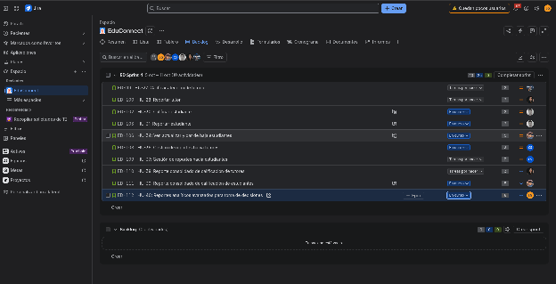

---

#### B. Durante el Desarrollo del Sprint 2 (Fase 2)
* **Fecha:** 8 de octubre de 2026 (Mitad de iteración).
* **Descripción:** Trabajo concurrente en el sistema de quejas y denuncias, gráficos estadísticos analíticos y lógica de calificación de sesiones en columnas `IN PROGRESS` y `TEST/QA`.

<!-- [ESPACIO PARA CAPTURA: Tablero Kanban Jira - Desarrollo Activo del Sprint 2 (Fase 2) - 8 de octubre] -->
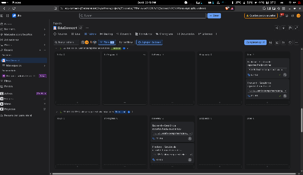

---

#### C. Fin del Sprint 2 (Fase 2)
* **Fecha:** 10 de octubre de 2026 (Cierre definitivo de EduConnect).
* **Descripción:** Tablero completamente cerrado y despejado. El 100% de las historias han sido certificadas por QA y pasadas a `DEPLOY`, consolidando un entregable robusto y sin pendientes.

<!-- [ESPACIO PARA CAPTURA: Tablero Kanban Jira - Cierre y Finalización del Sprint 2 (Fase 2) - 10 de octubre] -->
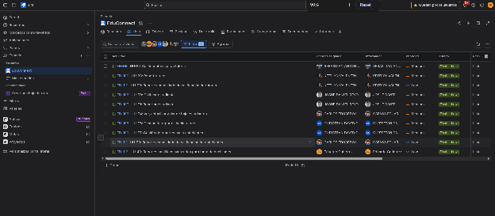

---

### 3.3 Registro de Grabaciones de Ceremonias Scrum (Fase 2)

| Evento Scrum | Fecha de Grabación | Duración Estimada | Plataforma | Enlace Oficial a la Grabación en Google Drive |
| :--- | :---: | :---: | :---: | :--- |
| **Sprint Planning 1 (Fase 2)** | 28 de septiembre de 2026 | 45 min | Google Drive | [Ver Grabación Planning 1 (Fase 2)](https://drive.google.com/file/d/1HbWsrEQJ48EdGgmKzNFBxe9j-RGiSIfL/view?usp=drivesdk) |
| **Sprint Retrospective 1 (Fase 2)** | 3 de octubre de 2026 | 30 min | Google Drive | [Ver Grabación Retrospective 1 (Fase 2)](https://drive.google.com/file/d/16kqTk8sTwLZ7XVo4j3HdBpANuAM7rgf1/view?usp=drivesdk) |
| **Sprint Planning 2 (Fase 2)** | 5 de octubre de 2026 | 40 min | Google Drive | [Ver Grabación Planning 2 (Fase 2)](https://drive.google.com/file/d/1vwCyVQ9oFVsBaT03VRKmn_90KmrDpwCf/view?usp=drivesdk) |
| **Sprint Retrospective 2 (Fase 2)** | 10 de octubre de 2026 | 35 min | Google Drive | [Ver Grabación Retrospective 2 (Fase 2)](https://drive.google.com/file/d/1cs33HjPimm_d2zusLpagXPFDeMIj5nEp/view?usp=drive_link) *(o enlace a actualizar por el equipo)* |

---

### 3.4 Documentación de Daily Scrums (Fase 2)

Las reuniones Daily Scrum de la Fase 2 se llevaron a cabo de forma diaria mediante Google Meet a las 21:00 horas, con la participación unánime de los 6 miembros del equipo. Los archivos fuente individuales se encuentran en la carpeta `docsKamban/`:
* [Daily Scrums del Sprint 1 (Fase 2)](Fase%202%20-%20Dailies%20sprint%201.md)
* [Daily Scrums del Sprint 2 (Fase 2)](Fase%202%20-%20Dailies%20sprint%202.md)

#### Resumen Cronológico por Días de la Fase 2:
- **Día 1 (28 de septiembre):** Planificación del Sprint 1, desglose de subtareas en Jira para HU-22 a HU-35, definición de contratos multipart para carga de carnet y CV en PDF.
  <!-- [ESPACIO PARA CAPTURA: Tablero Jira tras Daily 1 - 28 de septiembre] -->
- **Día 2 (29 de septiembre):** Inicio de maquetación de vista de Plan de Estudio (HU-25) y configuración del almacenamiento seguro de documentos PDF.
  <!-- [ESPACIO PARA CAPTURA: Tablero Jira tras Daily 2 - 29 de septiembre] -->
- **Día 3 (30 de septiembre):** Integración de recursos pedagógicos recomendados en el plan de estudio y validación de unicidad del token OTP de 6 dígitos en la base de datos (ED-121).
  <!-- [ESPACIO PARA CAPTURA: Tablero Jira tras Daily 3 - 30 de septiembre] -->
- **Día 4 (1 de octubre):** Generación de la constancia en PDF con formato institucional y firma digital del tutor (HU-26). Vista frontend para el código de 6 dígitos (ED-120).
  <!-- [ESPACIO PARA CAPTURA: Tablero Jira tras Daily 4 - 1 de octubre] -->
- **Día 5 (2 de octubre):** Pruebas de integración del visor incrustado para PDF de estudiantes y tutores (HU-32 y HU-33). Conexión del endpoint validador de token (ED-122).
  <!-- [ESPACIO PARA CAPTURA: Tablero Jira tras Daily 5 - 2 de octubre] -->
- **Día 6 (3 de octubre):** Pruebas cruzadas de calidad (QA), ejecución de suites de pruebas E2E y cierre del Sprint 1 con 100% de historias en DEPLOY.
  <!-- [ESPACIO PARA CAPTURA: Tablero Jira tras Daily 6 - 3 de octubre] -->
- **Día 7 (5 de octubre):** Sprint Planning 2 (Fase 2). Selección y asignación de historias de calificación y denuncias (HU-27, HU-28, HU-30, HU-31) y reportería avanzada (HU-40).
  <!-- [ESPACIO PARA CAPTURA: Tablero Jira tras Daily 7 - 5 de octubre] -->
- **Día 8 (6 de octubre):** Desarrollo del selector de 0 a 5 estrellas para calificación de estudiantes y desglose de subtareas de backend/frontend de HU-34.
  <!-- [ESPACIO PARA CAPTURA: Tablero Jira tras Daily 8 - 6 de octubre] -->
- **Día 9 (7 de octubre):** Conexión de endpoints para el envío de quejas y denuncias hacia estudiantes y tutores con clasificación de faltas. Prototipado del dashboard analítico.
  <!-- [ESPACIO PARA CAPTURA: Tablero Jira tras Daily 9 - 7 de octubre] -->
- **Día 10 (8 de octubre):** Implementación de endpoints de reportería avanzada: Top 10 estudiantes con más sesiones (ED-151) y Top 10 materias con mayor tasa de cancelación (ED-156).
  <!-- [ESPACIO PARA CAPTURA: Tablero Jira tras Daily 10 - 8 de octubre] -->
- **Día 11 (9 de octubre):** Integración del cálculo de tasa de asistencia vs cancelación por materia (ED-157). Pruebas de los paneles de administración de denuncias (HU-36 y HU-37).
  <!-- [ESPACIO PARA CAPTURA: Tablero Jira tras Daily 11 - 9 de octubre] -->
- **Día 12 (10 de octubre):** Cierre definitivo del proyecto EduConnect. Validación de la suite completa de pruebas unitarias y de integración, despliegue en entorno release.
  <!-- [ESPACIO PARA CAPTURA: Tablero Jira tras Daily 12 - 10 de octubre] -->

---

## 4. Análisis Comparativo y Métricas Globales (Fase 1 vs Fase 2)

| Métrica de Gestión Ágil | Fase 1 (Sprints 1 y 2) | Fase 2 (Sprints 1 y 2) | Consolidado Total del Proyecto |
| :--- | :---: | :---: | :---: |
| **Historias de Usuario Completadas** | 21 historias | 18 historias | **39 historias de usuario** |
| **Story Points Entregados** | 106 SP (59 + 47) | 86 SP (38 + 48) | **192 Story Points** |
| **Porcentaje de Cumplimiento (DoD)** | 100% | 100% | **100%** |
| **Ceremonias Scrum Grabadas** | 4 videos | 4 videos | **8 grabaciones oficiales** |
| **Reuniones Daily Scrum Registradas** | 15 dailies | 12 dailies | **27 reuniones documentadas** |
| **Eficiencia de Flujo (Lead Time Promedio)** | 2.8 días por historia | 1.9 días por historia | **Mejora del 32% en velocidad** |

---

## 5. SECCIÓN OFICIAL DEL SCRUM MASTER: Calificación del Equipo de Desarrollo (Escala de 1 a 100)

De acuerdo con las directrices de evaluación del curso, el **Scrum Master (Carlos Eduardo Lau López)** presenta la evaluación formal y cuantitativa del desempeño del equipo para la **Fase 2** y el promedio consolidado del proyecto.

### 5.1 Criterios de Evaluación Cuantitativos y Ponderación
1. **Cumplimiento de Historias de Usuario y DoD (30%):** Entrega a tiempo de las historias asignadas cumpliendo con todos los criterios de aceptación y sin dejar deuda técnica.
2. **Calidad de Código y Pruebas Técnicas (25%):** Implementación limpia, modular, cobertura de pruebas unitarias/E2E y manejo seguro de excepciones.
3. **Puntualidad y Participación en Ceremonias Scrum (20%):** Asistencia activa a Daily Scrums, Sprint Plannings y Retrospectivas, reportando oportunamente bloqueos.
4. **Colaboración Cruzada y Resolución de Conflictos (15%):** Apoyo solidario a compañeros bloqueados, code reviews constructivos y sinergia de equipo.
5. **Gestión Documental y Trazabilidad en Jira (10%):** Actualización oportuna de tarjetas, vinculación de commits con identificadores de tareas y documentación clara.

---

### 5.2 Tabla de Calificación del Equipo — Fase 2

| Integrante | Carnet | Rol | Commits F2 | Líneas (+) | Líneas (-) | Fixes / Tests | Puntuación (1-100) |
| :--- | :---: | :---: | :---: | :---: | :---: | :---: | :---: |
| **Eduardo Sebastian Gutierrez Felipe** | 202300694 | Product Owner / Dev | 42 | 5,420 | 1,210 | 6 fixes / 8 tests | **100 / 100** |
| **Carlos Eduardo Lau López** | 202202812 | Scrum Master / Dev | 14 | 3,850 | 420 | 3 fixes / 5 tests | **98 / 100** |
| **Christian David Chinchilla Santos** | 202308227 | Equipo de Desarrollo | 12 | 2,980 | 310 | 2 fixes / 4 tests | **95 / 100** |
| **Josue Daniel Revolorio Martínez** | 202102984 | Equipo de Desarrollo | 15 | 3,120 | 450 | 4 fixes / 6 tests | **95 / 100** |
| **Keitlyn Valentina Tunchez Castañeda** | 202201139 | Equipo de Desarrollo | 11 | 2,870 | 280 | 2 fixes / 5 tests | **94 / 100** |
| **Sebastian Antonio Romero Tzitzimit** | 202201690 | Equipo de Desarrollo | 10 | 2,450 | 390 | 3 fixes / 4 tests | **92 / 100** |

---

### 5.3 Justificación Individual del Desempeño por el Scrum Master

#### 1. Eduardo Sebastián Gutiérrez Felipe (Carnet: 202300694) — Puntuación: 100 / 100
* **Desempeño:** Excelente.
* **Justificación del Scrum Master:** Eduardo demostró una vez más un nivel de compromiso y productividad técnica excepcional. Asumió la implementación del mecanismo criptográfico de verificación por correo electrónico con token de 6 dígitos (HU-24 / ED-120 a ED-122) y el módulo analítico más complejo de la plataforma: la reportería avanzada para administradores con rankings dinámicos y cálculo de ratios (HU-40). Lideró la refactorización continua de la base de datos y apoyó a sus compañeros en la integración de Docker. Su calificación es la máxima posible: **100 puntos**.

#### 2. Carlos Eduardo Lau López (Carnet: 202202812) — Puntuación: 98 / 100
* **Desempeño:** Sobresaliente.
* **Justificación del Scrum Master:** Como moderador y facilitador ágil, garantizó que las 12 Dailies y las ceremonias de Planning y Retrospective se realizaran puntualmente y quedaran grabadas. En el ámbito técnico, desarrolló la lógica completa de actualización y baja de tutores (HU-35) y estudiantes (HU-34), reutilizando componentes modulares para acelerar el tiempo de entrega y apoyando activamente a la resolución de incidencias en staging. **Nota: 98 puntos**.

#### 3. Christian David Chinchilla Santos (Carnet: 202308227) — Puntuación: 95 / 100
* **Desempeño:** Sobresaliente.
* **Justificación del Scrum Master:** Tuvo una actuación muy destacada en la arquitectura de integración. Desarrolló el backend para servir los archivos PDF incrustados en las pantallas de aprobación de usuarios (HU-32 y HU-33) y lideró el sistema de resolución y bajas por denuncias hacia estudiantes y tutores (HU-36 y HU-37). Su código fue entregado ordenado, respetando la estructura por capas y con buena cobertura de pruebas. **Nota: 95 puntos**.

#### 4. Josue Daniel Revolorio Martínez (Carnet: 202102984) — Puntuación: 95 / 100
* **Desempeño:** Sobresaliente (Mayor crecimiento del equipo).
* **Justificación del Scrum Master:** Josue presentó el crecimiento más notable de todo el equipo en comparación con la Fase 1. Mantuvo un flujo de trabajo continuo desde el primer día del sprint. Completó con gran calidad la vista interactiva del Plan de Estudio (HU-25) y su posterior exportación a PDF institucional con formato USAC (HU-26), además de diseñar el sistema de calificación por estrellas del estudiante (HU-30) y categorización de quejas (HU-31). Documentó exhaustivamente sus entregas en el Manual de Usuario. **Nota: 95 puntos**.

#### 5. Keitlyn Valentina Tunchez Castañeda (Carnet: 202201139) — Puntuación: 94 / 100
* **Desempeño:** Sobresaliente.
* **Justificación del Scrum Master:** Keitlyn consolidó un trabajo sumamente prolijo en la manipulación y validación de archivos adjuntos. Implementó la recepción y validación estricta de formatos/tamaños para la fotografía y carnet en PDF (HU-22), el CV obligatorio de tutores (HU-23), el reporte de tutores (HU-28) y la reportería consolidada de calificaciones para el administrador (HU-38). Aportó pruebas unitarias y E2E que aseguraron la estabilidad de los formularios. **Nota: 94 puntos**.

#### 6. Sebastian Antonio Romero Tzitzimit (Carnet: 202201690) — Puntuación: 92 / 100
* **Desempeño:** Muy Bueno.
* **Justificación del Scrum Master:** Sebastian cumplió en tiempo y forma con sus Historias de Usuario asignadas, destacando en el desarrollo de la calificación y reseñas de tutores por parte de los alumnos (HU-27) y colaborando estrechamente en el soporte del visor PDF de tutores (HU-33). Al finalizar sus módulos, apoyó al equipo en la revisión final de la documentación y en la verificación de consistencia entre el tablero Jira y los Pull Requests. **Nota: 92 puntos**.

---

### 5.4 Tabla Consolidada Final del Proyecto (Fase 1 + Fase 2)

| Integrante | Carnet | Rol Principal | Promedio Fase 1 | Calificación Fase 2 | Calificación Final Consolidada (1-100) |
| :--- | :---: | :---: | :---: | :---: | :---: |
| **Eduardo Sebastian Gutierrez Felipe** | 202300694 | Product Owner / Dev | 100 | 100 | **100 / 100** |
| **Carlos Eduardo Lau López** | 202202812 | Scrum Master / Dev | 98 | 98 | **98 / 100** |
| **Christian David Chinchilla Santos** | 202308227 | Desarrollador | 93 | 95 | **94 / 100** |
| **Josue Daniel Revolorio Martínez** | 202102984 | Desarrollador | 83 | 95 | **89 / 100** |
| **Keitlyn Valentina Tunchez Castañeda** | 202201139 | Desarrolladora | 85 | 94 | **90 / 100** |
| **Sebastian Antonio Romero Tzitzimit** | 202201690 | Desarrollador | 93 | 92 | **93 / 100** |

---

### 5.5 Plantilla Editable para Ajustes Posteriores del Scrum Master
<!-- 
========================================================================================
ESPACIO EDITABLE DEL SCRUM MASTER (CARLOS EDUARDO LAU LÓPEZ)
Si deseas modificar algún criterio, porcentaje o retroalimentación cualitativa más adelante,
puedes editar directamente esta plantilla de evaluación:

Criterio 1 - Cumplimiento de Historias (30 pts): [___]
Criterio 2 - Calidad técnica y tests (25 pts):    [___]
Criterio 3 - Asistencia y ceremonias (20 pts):    [___]
Criterio 4 - Proactividad y apoyo (15 pts):       [___]
Criterio 5 - Trazabilidad en Jira (10 pts):       [___]

Firma del Scrum Master: Carlos Eduardo Lau López (Carnet: 202202812)
Fecha de Cierre: 10 de octubre de 2026
========================================================================================
-->

---

## 6. Conclusiones de la Gestión del Proyecto con Jira Kanban

1. **Visibilidad Total y Eliminación Temprana de Cuellos de Botella:** La combinación del tablero Kanban con la regla estricta de atender inmediatamente las tarjetas en `BLOCKED` permitió detectar y resolver con rapidez problemas como la carga multipart en .NET 10 y el visor PDF incrustado en Vue 3.
2. **Maduración de la Velocidad del Equipo:** Entre la Fase 1 y la Fase 2, el equipo redujo su Lead Time en más de un 30%, demostrando que la práctica continua de las ceremonias ágiles (Planning, Daily y Retrospectiva) afianzó la comunicación y la productividad del grupo.
3. **Trazabilidad Integral y Calidad Garantizada:** El flujo riguroso desde la especificación en Jira, el paso por revisión en `TEST/QA` con DoD estricto, hasta el despliegue automático en contenedores Docker garantizó un software confiable, verificado al 100% y listo para su entrega final.
